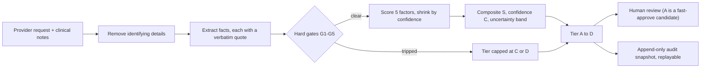
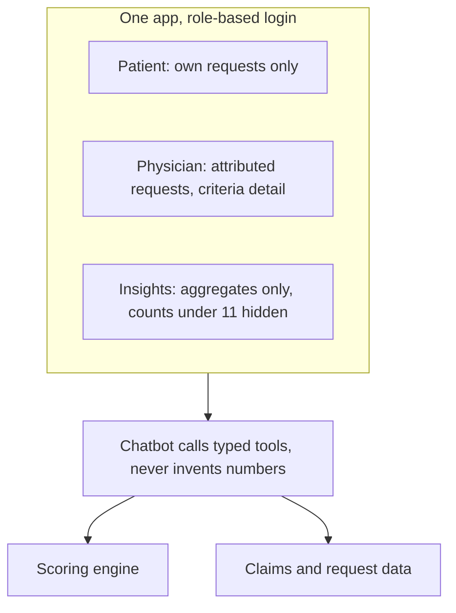
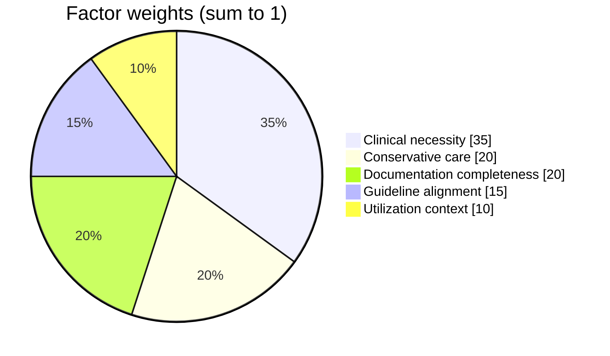
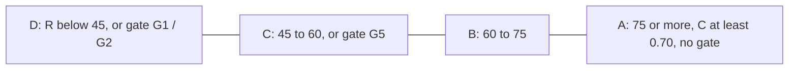
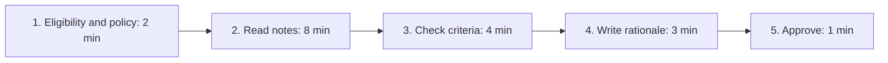
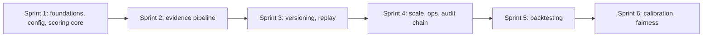
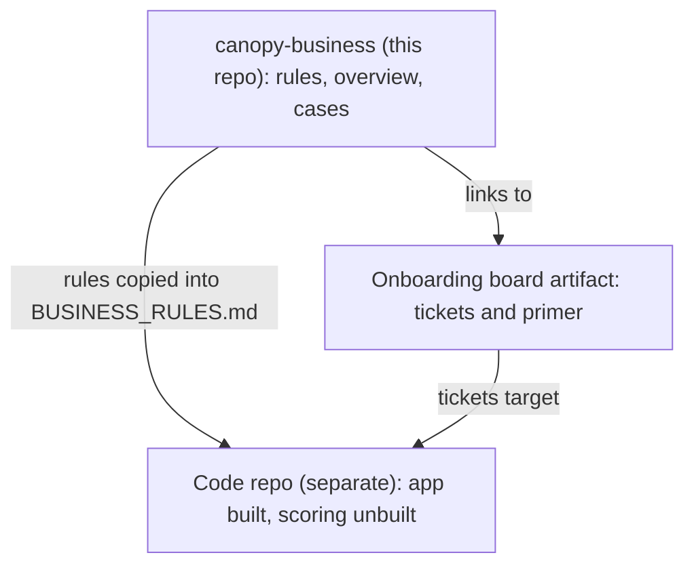

<!-- Review note: one-page visual condensation of the README and cases, with a reviewer checklist. Derived from the other files; edit those first. -->
# Prior Authorization Copilot: Review Summary

One page, pictures first. Details live in [`README.md`](README.md) and [`cases/`](cases/README.md).
**Status:** draft for review. All weights, cut-offs and savings figures are placeholders, and external figures are unverified (grade B).

---

## 1. The idea in one picture

**Rule that never bends:** the system only recommends fast approval or hands a case to a human. It never denies.

---

## 2. Who uses it

Access control is enforced in the server and tools, never by prompt instructions.

---

## 3. How a score is built

| Piece | Rule |
|---|---|
| Factor score | `C x raw + (1 - C) x 40` (thin evidence pulls toward caution) |
| Evidence confidence | `source trust x 0.5^(age / half-life)`, times 0.9 if AI-extracted |
| Source trust | claim 0.95, EHR 0.90, signed note 0.80, referral 0.65, self-report 0.50 |
| Rating | `0.65 x S_low + 0.20 x momentum term + 0.15 x 100 x C` |
| Worked example | S = **73.4375**, C = 0.7575, tier B |

Gates: **G1** exclusion, **G2** mandatory element missing, **G3** expedited (72h), **G4** ungrounded fact discarded, **G5** conflicting evidence.
Missing evidence can only keep a tier the same or lower it. A tripped gate caps the tier whatever S is.

---

## 4. What a nurse does today, and where time goes

| | Today | With fast lane |
|---|---|---|
| Minutes (illustrative) | 18 | 8 |
| Cost at $0.975 per minute | $17.55 | $7.80 |
| Saved per case | | **$9.75** |

Most time is retrieval and re-typing (steps 2 to 4). Judgment sits in step 3 and the exits. The platform pre-assembles evidence and never decides the unusual cases.
Minutes are assumptions. Time becomes dollars only if staffing or backlog changes.

---

## 5. What it could be worth

| Case | Scope | Conservative | Base | Ambitious |
|---|---|---|---|---|
| [001](cases/001-medicare-advantage-reviewer-time.md) | All Medicare Advantage plans, per year | $10.3M | $51.7M | $139.5M |
| 001 | Reviewer FTEs freed | 85 | 425 | 1,147 |
| [002](cases/002-physician-practice-burden.md) | Per physician per year (value to providers) | $520 | $2,080 | $4,680 |
| [003](cases/003-lumbar-mri-service-line.md) | Lumbar MRI service line | blocked on data | | |

Base case: each $1M of annual platform cost needs about **102,600** fast-tracked requests to break even.
The biggest unknowns are how much review is already automated and the real minutes saved.

---

## 6. How it gets built

- **Onboarding week:** ten tickets in five days (PA-101 to PA-110), learning by building.
- **Code repo:** a separate repo with everything built except `app/scoring/`, which is the developer's module. A stand-in scorer keeps the product running meanwhile.
- **MVP:** synthetic data, three policies (lumbar MRI, knee arthroscopy, GLP-1), physician chatbot, audit log.

---

## 7. For reviewers: decisions and checks

- [ ] Is "never denies, humans decide adverse outcomes" the right stance for the pitch?
- [ ] Are the five factors and weights the right shape? (Utilization context may penalize providers unfairly.)
- [ ] Are tier cut-offs 75 / 60 / 45 and the A rule (R at least 75, C at least 0.70) acceptable as starting points?
- [ ] Should tier A skip nurse review entirely? Case 001 assumes a nurse still signs off (10 minutes saved, not 18).
- [ ] Is a measured reviewer time study achievable? It would replace the invented minutes.
- [ ] Case 001 is an industry ceiling. Can we get UnitedHealthcare's own figures?
- [ ] Who owns the clinical content and the scoring rules?

**Known issues**
- The business README rounds S to 73.5. Exact arithmetic gives 73.4375.
- Primary sources (KFF, BLS, AMA) were not opened. All sourced figures are unverified.
- Legal, privacy and security review is required before any real data or deployment.
