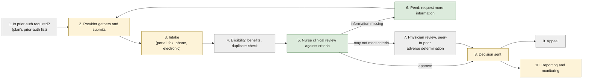
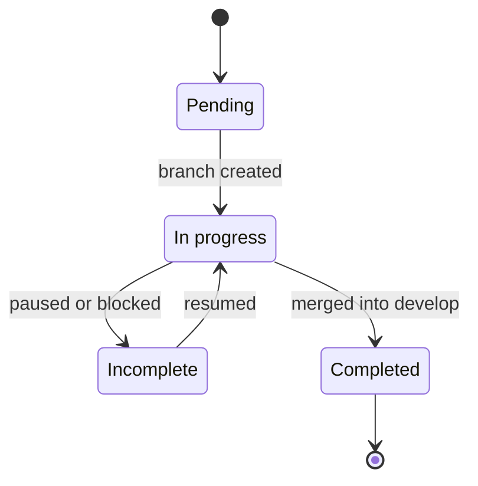
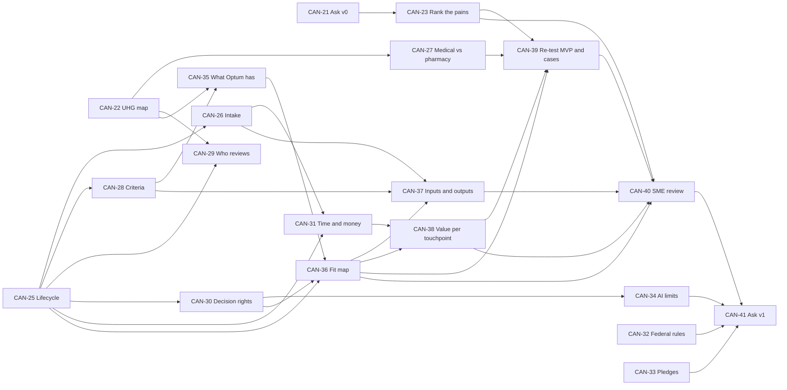

<!-- Review note: the project's ticket list, rewritten 2026-11-06 around one goal: confirm what the business is asking for and which part of Optum's prior-authorization process Project Canopy will resolve. Every story states a current understanding to be confirmed or corrected. Old tickets CAN-1 to CAN-20 are retired. -->
# Project Canopy: Roadmap

## Contents

<!-- contents:start -->
- [1. Purpose of this roadmap](#1-purpose-of-this-roadmap)
- [2. Starting picture: where I think Canopy steps in](#2-starting-picture-where-i-think-canopy-steps-in)
- [3. How we work](#3-how-we-work)
  - [Story format](#story-format)
  - [Understanding status](#understanding-status)
  - [Ticket status](#ticket-status)
  - [Roadmap sync](#roadmap-sync)
- [4. Ladder (by phase)](#4-ladder-by-phase)
- [5. Dependency map](#5-dependency-map)
- [6. Stories](#6-stories)
  - [Phase 1: Frame the ask](#phase-1-frame-the-ask)
  - [Phase 2: How prior authorization works today](#phase-2-how-prior-authorization-works-today)
  - [Phase 3: Why now](#phase-3-why-now)
  - [Phase 4: Where Canopy steps in](#phase-4-where-canopy-steps-in)
  - [Phase 5: Confirm](#phase-5-confirm)
- [7. Status board](#7-status-board)
- [8. Retired tickets](#8-retired-tickets)
<!-- contents:end -->

[Overview](README.md) · [Cases](cases/README.md) · [Manual flow](manual-flows/lumbar-mri-vs-glp1-nurse-trace.md) · [Review summary](REVIEW_SUMMARY.md)

## 1. Purpose of this roadmap

This repo exists to answer two questions before any more is built:

1. **What is the business asking for?** Who at Optum wants this, which problem they mean, and how they will judge success.
2. **Which part of prior authorization will Canopy resolve?** Where in the end-to-end process it steps in, where it only helps, and what it leaves alone.

Every story below starts from **what I think is true today** and ends with that belief confirmed, corrected, or still open. The README, the cases and the manual flow were written on these beliefs, so a correction here may change them.

## 2. Starting picture: where I think Canopy steps in

This is a hypothesis. CAN-36 replaces it with a confirmed version.

| Colour | Meaning | Stages | Canopy part |
|---|---|---|---|
| Green | **Core.** Canopy changes how this stage works. | 5 nurse review, 6 pend | Evidence extraction with quotes, gates, scoring, tier routing, missing-item list |
| Yellow | **Adjacent.** Canopy helps, but another system or team owns the stage. | 2 submit, 3 intake, 8 notify, 10 reporting | Provider "what is missing" chatbot, packet reading, member status chatbot, insights assistant |
| Grey | **Out.** Canopy does not touch it, or only hands over evidence. | 1 prior-auth list, 4 eligibility, 7 physician decision and denial, 9 appeal | None. Denials stay with licensed clinicians. |

## 3. How we work

| Rule | Detail |
|---|---|
| Base branch | `develop`. Stories merge back into it when finished. |
| Story branch | One per ticket, named `story/CAN-<n>-<slug>`. None are created yet. We create them one at a time. |
| Dependencies | If a ticket depends on another, I flag it **before** its branch is created, and we decide together whether to wait or stack. |
| Complexity | XS 1 point, S 2, M 3, L 5, XL 8 to 13. Points reflect effort and uncertainty, not calendar time. |
| Evidence | Any number in a story's output goes in [`cases/registry.md`](cases/registry.md) first, with a grade. Public facts about Optum or UnitedHealthcare are grade B until the primary source is opened. |
| Outputs | Each story writes one file under `docs/understanding/`, unless the story names another place. |
| Order | Stories are ordered by phase, not by size, because each phase builds the understanding the next one needs. |

### Story format

Every story has the same six parts.

| Part | What it holds |
|---|---|
| **I think** | My current understanding, in one or two sentences. This is what the story checks. |
| **Check by** | The questions to answer and where the answer comes from: public sources, the sponsor, or a subject-matter expert (SME). |
| **If I'm wrong** | What in the project changes. This shows how much rides on the belief. |
| **Done when** | The finish line. |
| **Output** | The file the story produces. |
| **Needs** | Anything outside the repo: network access, a person, data. |

### Understanding status

Separate from ticket status. A ticket can be Completed while its belief is still only Partly confirmed.

| Status | Meaning |
|---|---|
| Unchecked | Nobody has tested the belief yet |
| Partly confirmed | Public sources agree, but nobody inside the business has confirmed it |
| Confirmed | The sponsor or an SME agreed, and their answer is recorded |
| Corrected | The belief was wrong. The story records the correct version and what it changes. |

### Ticket status

| Status | Meaning |
|---|---|
| Pending | No branch yet. A ticket whose dependency is unfinished is still Pending, with a note. |
| In progress | Branch exists and work is active |
| Incomplete | Branch exists but work stopped. The reason is recorded: a dependency, a decision, data, an SME, or your review. |
| Completed | Merged into `develop`, with its story file archived |

The board in section 7 is the source of truth. If a branch's `STORY.md` shows a different status, the board wins.

### Roadmap sync

1. `ROADMAP.md` changes only in roadmap-only commits on the base branch. Story branches never edit it.
2. After each such commit, the base branch is merged into every open story branch so they all carry the same file.
3. Status changes are roadmap-only commits too. Pushing any of them still needs your consent.

## 4. Ladder (by phase)

| Key | Story | Phase | Size | Pts | Depends on |
|---|---|---|---|---|---|
| CAN-21 | Write down the business ask as I understand it | 1 Frame | XS | 1 | none |
| CAN-22 | Map UnitedHealth Group and find who owns the problem | 1 Frame | S | 2 | none |
| CAN-23 | Rank the pains the ask is really about | 1 Frame | S | 2 | CAN-21 |
| CAN-24 | Glossary in the business's own words | 1 Frame | S | 2 | none |
| CAN-25 | End-to-end prior-authorization lifecycle | 2 Today | M | 3 | none |
| CAN-26 | Intake channels and what arrives structured | 2 Today | S | 2 | CAN-25 |
| CAN-27 | Medical benefit vs pharmacy benefit | 2 Today | M | 3 | CAN-22 |
| CAN-28 | Who writes the criteria | 2 Today | M | 3 | CAN-25 |
| CAN-29 | Who actually reviews each service | 2 Today | S | 2 | CAN-22, CAN-25 |
| CAN-30 | Decision rights and the human line | 2 Today | S | 2 | CAN-25 |
| CAN-31 | Where time and money go, stage by stage | 2 Today | M | 3 | CAN-25, CAN-26 |
| CAN-32 | Federal rules and their deadlines | 3 Why now | M | 3 | network access |
| CAN-33 | Industry and UnitedHealthcare pledges to cut prior auth | 3 Why now | M | 3 | network access |
| CAN-34 | Limits on AI in utilization review | 3 Why now | M | 3 | CAN-30, network access |
| CAN-35 | What Optum already has | 3 Why now | L | 5 | CAN-22, CAN-28, network access |
| CAN-36 | Fit map: Canopy on the lifecycle | 4 Step in | L | 5 | CAN-25, CAN-30, CAN-35 |
| CAN-37 | What we need from Optum and what we hand back | 4 Step in | M | 3 | CAN-26, CAN-28, CAN-36 |
| CAN-38 | Value hypothesis for each touchpoint | 4 Step in | L | 5 | CAN-31, CAN-36 |
| CAN-39 | Re-test the MVP and the cases against the ask | 4 Step in | L | 5 | CAN-23, CAN-27, CAN-36, CAN-38 |
| CAN-40 | Understanding review with a business SME | 5 Confirm | XL | 8 | CAN-23, CAN-36, CAN-37, CAN-38, CAN-39, an SME |
| CAN-41 | Business ask statement v1 | 5 Confirm | XL | 8 | CAN-32, CAN-33, CAN-34, CAN-40 |

Total: 21 stories, 73 points.

## 5. Dependency map

Stories that can start any time: CAN-21, 22, 24, 25, 32 and 33. CAN-32 to 35 need the research environment to reach external sites. CAN-40 needs a person inside the business.

## 6. Stories

### Phase 1: Frame the ask

**CAN-21 · Write down the business ask as I understand it** · XS · 1 pt
- **I think:** Optum wants to cut the cost and turnaround time of clinical prior-auth review on the payer side, mainly by moving well-documented requests through faster, without more wrong approvals and without any AI-made denials.
- **Check by:** Who asked, in what words, and what decision will they make with our output (fund a pilot, buy, build, stop)? Is this an internal efficiency ask, a product to sell, or a compliance ask?
- **If I'm wrong:** If the ask is provider-side (less burden for doctors' offices) or compliance-side (meet federal deadlines and APIs), the core of Canopy moves from stage 5 to stages 2 or 10.
- **Done when:** one paragraph, marked v0, plus the five questions it cannot yet answer. Becomes the baseline that CAN-41 replaces.
- **Output:** `docs/understanding/business-ask-v0.md`

**CAN-22 · Map UnitedHealth Group and find who owns the problem** · S · 2 pts
- **I think:** UnitedHealthcare is the insurer and legally makes the coverage decision. Optum is the health-services side, split into Optum Health (care delivery), Optum Insight (data, technology and services, including what came from Change Healthcare) and Optum Rx (pharmacy benefits). Our sponsor sits in one of these, and that choice decides who the customer and the user are.
- **Check by:** Which unit is the sponsor? Which unit's staff would use Canopy? Is the customer UnitedHealthcare's own members, or other payers that buy from Optum?
- **If I'm wrong:** Three different projects hide behind the same name. (a) Internal tool for UnitedHealthcare's utilization management. (b) Optum Insight product sold to other health plans. (c) Optum Rx tool for drug prior auth. Each has a different user, data access and business case.
- **Done when:** an org picture showing the sponsor, the customer and the user, with the chosen option (a, b or c) and the reason.
- **Output:** `docs/understanding/uhg-map.md`

**CAN-23 · Rank the pains the ask is really about** · S · 2 pts · depends on CAN-21
- **I think:** In order: (1) reviewer cost and capacity, (2) meeting decision deadlines, (3) friction with providers, (4) delay and harm to members, (5) regulatory and legal exposure.
- **Check by:** Which pain does the sponsor name first? Which one has a budget behind it? Tie each pain to one metric the business already tracks.
- **If I'm wrong:** If provider friction or member delay ranks first, the provider chatbot and pend loop matter more than tier A fast-tracking, and Case 002 becomes the lead case instead of Case 001.
- **Done when:** five pains ranked, each with one metric, its owner, and the evidence for its rank.
- **Output:** `docs/understanding/pain-ranking.md`

**CAN-24 · Glossary in the business's own words** · S · 2 pts
- **I think:** Our README uses some terms differently from how a payer does. "Tier" and "gate" are ours. The business says utilization management (UM), precertification, notification, pend, peer-to-peer, adverse determination, gold carding, delegated review, and names standards such as X12 278, CRD, DTR and PAS.
- **Check by:** Public UnitedHealthcare provider guides, CMS definitions, and the SME session (CAN-40).
- **If I'm wrong:** If we use the wrong word for a stage, the sponsor will hear a different scope than we mean.
- **Done when:** each term has a plain definition, the business's usage, and our usage where they differ.
- **Output:** `docs/glossary.md`

### Phase 2: How prior authorization works today

**CAN-25 · End-to-end prior-authorization lifecycle** · M · 3 pts
- **I think:** The ten stages in section 2 cover the whole journey, from "is it required?" to appeal. The decision clock starts at intake. Standard requests have 7 calendar days and expedited ones 72 hours.
- **Check by:** For each stage: who does it, which system, what goes in, what comes out, which clock applies, how it fails. Check against at least one public UnitedHealthcare provider guide and one SME.
- **If I'm wrong:** A missing or merged stage moves the boundary of what Canopy owns. For example, if eligibility and clinical review happen in one combined step, our input contract changes.
- **Done when:** a confirmed lifecycle diagram with one row per stage covering owner, system, input, output, clock and failure mode.
- **Output:** `docs/understanding/pa-lifecycle.md`

**CAN-26 · Intake channels and what arrives structured** · S · 2 pts · depends on CAN-25
- **I think:** Most requests still arrive through the provider portal, fax and phone. Fully electronic requests are a minority. The clinical packet usually arrives as scanned or faxed pages, which is why "read the documents" is the heaviest nurse step in the [manual flow](manual-flows/lumbar-mri-vs-glp1-nurse-trace.md).
- **Check by:** Share of requests by channel. Which fields arrive structured (member, codes, provider) and which do not (clinical history, exam, therapy dates)?
- **If I'm wrong:** If most packets arrive structured, the extraction value of Canopy shrinks and the value moves to scoring and routing alone.
- **Done when:** a channel table with shares (sourced or graded C) and a structured-vs-unstructured field list.
- **Output:** `docs/understanding/intake-channels.md`

**CAN-27 · Medical benefit vs pharmacy benefit** · M · 3 pts · depends on CAN-22
- **I think:** Lumbar MRI and knee arthroscopy are medical-benefit requests reviewed under UnitedHealthcare utilization management. GLP-1 drugs are usually a pharmacy-benefit request handled by the pharmacy benefit manager (Optum Rx), with different criteria, systems, submission standards and rules. The federal prior-auth rule (CAN-32) does not cover drugs.
- **Check by:** For each MVP service: which benefit, which team, which criteria, which clock, which channel. Is drug prior auth in the sponsor's scope at all?
- **If I'm wrong:** If GLP-1 sits outside the sponsor's unit, it should leave the MVP, and the GLP-1 half of the manual flow becomes background rather than target.
- **Done when:** a side-by-side table and a recommendation to keep or drop GLP-1 from the MVP.
- **Output:** `docs/understanding/medical-vs-pharmacy.md`

**CAN-28 · Who writes the criteria** · M · 3 pts · depends on CAN-25
- **I think:** The plan decides which services need prior auth. Licensed criteria sets (InterQual, now part of Optum through Change Healthcare, or MCG) and the plan's own medical policies decide what "meets criteria" means. For Medicare Advantage, traditional Medicare coverage rules come first where they exist. Canopy applies criteria. It never writes them.
- **Check by:** For each MVP service, the criteria source and owner. Can Canopy encode licensed criteria, or only point to them? How often do criteria versions change?
- **If I'm wrong:** If we cannot encode licensed criteria, the "policy" records in the scoring engine have to come from the plan's own policies or a licensed integration, which changes the build and the cost model.
- **Done when:** a table of service, criteria source, owner, version cadence and licensing question, with the licensing question raised to the sponsor.
- **Output:** `docs/understanding/criteria-ownership.md`

**CAN-29 · Who actually reviews each service** · S · 2 pts · depends on CAN-22, CAN-25
- **I think:** Not every category is reviewed by an in-house nurse. Some, such as advanced imaging, post-acute care or specialty drugs, may be delegated to a specialty program or a vendor. Our nurse persona assumes in-house review for lumbar MRI.
- **Check by:** For each MVP service and line of business (commercial, Medicare Advantage, Medicaid): which organization reviews it?
- **If I'm wrong:** If lumbar MRI goes to a delegated imaging program, the user is that program's reviewer and our "UM Workbench" picture is wrong.
- **Done when:** a map of service and line of business to reviewing organization.
- **Output:** `docs/understanding/who-reviews.md`

**CAN-30 · Decision rights and the human line** · S · 2 pts · depends on CAN-25
- **I think:** A nurse can approve a request that meets criteria. Only a physician or other appropriate clinician can issue an adverse determination. Peer-to-peer happens around a possible denial. Appeals go to a different reviewer, and Medicare Advantage appeals can escalate to an independent review entity. Our rule "the system never denies" fits this.
- **Check by:** Who may approve, pend, deny, overturn? What must a denial notice say? Can an approval be automated with no human, and under what conditions?
- **If I'm wrong:** If even approvals need a human sign-off, tier A becomes "pre-filled for a one-click approval", not "auto-approve candidate", which changes the minutes saved in Case 001.
- **Done when:** a decision-rights table (who decides, who is consulted, who is told) for each stage, and principle 1 in the README confirmed or reworded.
- **Output:** `docs/understanding/decision-rights.md`

**CAN-31 · Where time and money go, stage by stage** · M · 3 pts · depends on CAN-25, CAN-26
- **I think:** Per request, reading documents is the biggest nurse step. Per case, pends, peer-to-peer calls and appeals are the most expensive, because they repeat work and pull in physicians.
- **Check by:** Cost and minutes per stage using registry rows. Which stages have no public data and need Optum's own numbers?
- **If I'm wrong:** If most cost sits in physician review or appeals, Canopy's best lever is a better evidence summary for physicians, not faster nurse approvals.
- **Done when:** a cost-by-stage table where every number is in the registry, plus a list of the numbers only Optum can provide.
- **Output:** `docs/understanding/cost-by-stage.md`

### Phase 3: Why now

**CAN-32 · Federal rules and their deadlines** · M · 3 pts · needs network access
- **I think:** The CMS Interoperability and Prior Authorization rule (CMS-0057-F) requires Medicare Advantage, Medicaid, CHIP and marketplace plans to decide within 72 hours (expedited) and 7 days (standard) from January 2026, give a specific reason for denials, publish prior-auth metrics from March 2026, and offer an electronic prior-auth API by January 2027. Drugs are excluded.
- **Check by:** Read the primary rule. For each requirement: the date, what it forces the business to do, and whether Canopy helps.
- **If I'm wrong:** If the ask is really "meet the 2027 API deadline", the project is an integration project and scoring is secondary.
- **Done when:** a timeline with one row per requirement and a column "does Canopy help: yes, partly, no", graded A from the primary source.
- **Output:** `docs/understanding/federal-rules.md`
- **Needs:** access to `www.cms.gov` and `www.federalregister.gov`

**CAN-33 · Industry and UnitedHealthcare pledges to cut prior auth** · M · 3 pts · needs network access
- **I think:** Health plans, UnitedHealthcare among them, pledged in 2025 to cut the number of services needing prior auth, honour approvals when members switch plans, and move toward real-time electronic decisions. UnitedHealthcare also runs a gold-card programme that exempts some high-approval providers. Fewer, easier requests are exactly the ones our tier A targets, so this may shrink our addressable volume.
- **Check by:** What was promised, by when, and what UnitedHealthcare has already removed. What share of today's volume is likely to disappear?
- **If I'm wrong:** If the remaining volume is mostly complex cases, the value case moves from fast-tracking clean cases to supporting hard ones.
- **Done when:** a list of commitments with dates and sources, and an assumption row in the registry for "share of volume removed by scope cuts".
- **Output:** `docs/understanding/pa-reduction-pledges.md`
- **Needs:** access to the primary pledge and UnitedHealthcare announcements

**CAN-34 · Limits on AI in utilization review** · M · 3 pts · depends on CAN-30 · needs network access
- **I think:** Several states, such as California with SB 1120, require that a licensed clinician makes medical-necessity decisions and that AI cannot deny on its own. CMS has told Medicare Advantage plans that algorithms must account for the individual patient. The lawsuit over the naviHealth post-acute tool makes this especially sensitive for UnitedHealth Group.
- **Check by:** List what is off-limits, what must be disclosed, and what must be audited. Test each README principle against the list.
- **If I'm wrong:** If some states restrict AI even in approval routing, the MVP needs a per-state switch, or must stay advisory only.
- **Done when:** a limits table with sources and each README principle marked "covers it" or "gap", labelled "for legal review, not legal advice".
- **Output:** `docs/understanding/ai-limits.md`
- **Needs:** access to state legislature sites, CMS guidance and court filings

**CAN-35 · What Optum already has** · L · 5 pts · depends on CAN-22, CAN-28 · needs network access
- **I think:** Optum already owns pieces of this: the InterQual criteria and their automation tools, the Change Healthcare network that carries electronic transactions, and provider-facing prior-auth tools. Other vendors, including those in the CMS WISeR model, already sell AI-assisted prior auth. Canopy must complement these, not repeat them.
- **Check by:** For each Canopy component (extraction, gates and scoring, routing, provider chatbot, member chatbot, insights), what Optum already does and what vendors offer.
- **If I'm wrong:** If Optum already scores and routes requests, our unique part may be only the explanation layer and the replayable audit trail.
- **Done when:** an overlap table marking each component "new", "complements", "duplicates" or "unknown", with sources.
- **Output:** `docs/understanding/existing-capabilities.md`

### Phase 4: Where Canopy steps in

**CAN-36 · Fit map: Canopy on the lifecycle** · L · 5 pts · depends on CAN-25, CAN-30, CAN-35
- **I think:** Canopy's core is stages 5 and 6 (nurse review and pend). It helps at stages 2, 3, 8 and 10, and stays out of 1, 4, 7 and 9, as drawn in section 2.
- **Check by:** Redraw section 2 on the confirmed lifecycle. For each stage, mark core, adjacent or out, and name the owner of everything marked out.
- **If I'm wrong:** This is the central belief of the repo. Any change here rewrites the README scope, the MVP and the cases.
- **Done when:** a confirmed fit map replaces section 2 of this roadmap, with a "what we don't solve, and who does" list.
- **Output:** `docs/understanding/fit-map.md`

**CAN-37 · What we need from Optum and what we hand back** · M · 3 pts · depends on CAN-26, CAN-28, CAN-36
- **I think:** Inputs are the request header, the clinical packet, claims history, eligibility and the criteria version. Outputs are a tier, the evidence with quotes and page references, and a list of missing items, placed in the reviewer's existing work queue. Canopy never writes the decision back.
- **Check by:** For each input: owner, how we would get it, whether it contains personal health information, licensing limits. For each output: who reads it and in which system.
- **If I'm wrong:** If the reviewer will not leave their current tool, Canopy must live inside it, which changes the product from an app to an add-on.
- **Done when:** an input and output table at the business level (no technical design), with each access question assigned to someone.
- **Output:** `docs/understanding/inputs-outputs.md`

**CAN-38 · Value hypothesis for each touchpoint** · L · 5 pts · depends on CAN-31, CAN-36
- **I think:** Most value comes from fewer nurse minutes on well-documented requests (stage 5) and fewer pend loops (stage 6). Provider and member value is real but harder to price.
- **Check by:** For each core or adjacent stage: which metric moves, who benefits, how big (three scenarios), and which number must come from Optum.
- **If I'm wrong:** If the biggest value is turnaround or compliance rather than cost, the business case is framed around risk avoided, not minutes saved.
- **Done when:** one row per touchpoint with metric, beneficiary, range and evidence grade, linked to the cases.
- **Output:** `docs/understanding/value-by-touchpoint.md`

**CAN-39 · Re-test the MVP and the cases against the ask** · L · 5 pts · depends on CAN-23, CAN-27, CAN-36, CAN-38
- **I think:** The MVP (three services, synthetic data, physician chatbot, tiers A to D) still fits, except that GLP-1 may belong to a different unit and Case 001 is an industry ceiling, not an Optum number.
- **Check by:** For each MVP choice and each case (001, 002, 003): keep, change or drop, with the reason taken from earlier stories.
- **If I'm wrong:** If the services or users are wrong, the MVP is rebuilt before any code depends on it.
- **Done when:** a keep, change or drop table, and a proposed edit to README sections 3 and 7 and to each case's framing, shown to you before any change is made.
- **Output:** `docs/understanding/mvp-retest.md`

### Phase 5: Confirm

**CAN-40 · Understanding review with a business SME** · XL · 8 pts · depends on CAN-23, CAN-36, CAN-37, CAN-38, CAN-39 · needs an SME
- **I think:** A one-hour session with someone who runs or sponsors prior auth at Optum can confirm or correct most beliefs in this roadmap.
- **Check by:** A short pack (the ask, the lifecycle, the fit map, the top ten open questions). Record each answer word for word.
- **If I'm wrong:** If no SME is available, beliefs stay at Partly confirmed and CAN-41 is marked as based on public sources only.
- **Done when:** every story on the board has its understanding status updated, with the SME's answer quoted in its output file.
- **Output:** `docs/understanding/sme-review.md`

**CAN-41 · Business ask statement v1** · XL · 8 pts · depends on CAN-32, CAN-33, CAN-34, CAN-40
- **I think:** By this point the ask fits on one page: sponsor, problem, users, the stages Canopy resolves, non-goals, success measures and constraints.
- **Check by:** Compare with v0 (CAN-21) and list every belief that changed.
- **If I'm wrong:** If the one-pager cannot be agreed, the project's scope is not settled, and building should wait.
- **Done when:** a one-page statement agreed by the sponsor, a "what changed since v0" list, and the README overview updated to match.
- **Output:** `docs/understanding/business-ask-v1.md`

## 7. Status board

Last updated: 2026-11-06 · **Pending 21** · In progress 0 · Incomplete 0 · Completed 0 · Understanding: **Unchecked 21**

| Key | Story | Status | Understanding | Branch | Note |
|---|---|---|---|---|---|
| CAN-21 | Business ask v0 | Pending | Unchecked | none | |
| CAN-22 | UnitedHealth Group map and problem owner | Pending | Unchecked | none | |
| CAN-23 | Rank the pains | Pending | Unchecked | none | waiting on CAN-21 |
| CAN-24 | Glossary | Pending | Unchecked | none | |
| CAN-25 | Prior-auth lifecycle | Pending | Unchecked | none | |
| CAN-26 | Intake channels | Pending | Unchecked | none | waiting on CAN-25 |
| CAN-27 | Medical vs pharmacy benefit | Pending | Unchecked | none | waiting on CAN-22 |
| CAN-28 | Who writes the criteria | Pending | Unchecked | none | waiting on CAN-25 |
| CAN-29 | Who reviews each service | Pending | Unchecked | none | waiting on CAN-22, CAN-25 |
| CAN-30 | Decision rights | Pending | Unchecked | none | waiting on CAN-25 |
| CAN-31 | Time and money by stage | Pending | Unchecked | none | waiting on CAN-25, CAN-26 |
| CAN-32 | Federal rules | Pending | Unchecked | none | needs network access |
| CAN-33 | Pledges to cut prior auth | Pending | Unchecked | none | needs network access |
| CAN-34 | Limits on AI | Pending | Unchecked | none | waiting on CAN-30, needs network access |
| CAN-35 | What Optum already has | Pending | Unchecked | none | waiting on CAN-22, CAN-28, needs network access |
| CAN-36 | Fit map | Pending | Unchecked | none | waiting on CAN-25, 30, 35 |
| CAN-37 | Inputs and outputs | Pending | Unchecked | none | waiting on CAN-26, 28, 36 |
| CAN-38 | Value per touchpoint | Pending | Unchecked | none | waiting on CAN-31, 36 |
| CAN-39 | Re-test MVP and cases | Pending | Unchecked | none | waiting on CAN-23, 27, 36, 38 |
| CAN-40 | SME review | Pending | Unchecked | none | waiting on CAN-23, 36, 37, 38, 39, needs an SME |
| CAN-41 | Business ask v1 | Pending | Unchecked | none | waiting on CAN-32, 33, 34, 40 |

## 8. Retired tickets

CAN-1 to CAN-20 were retired on 2026-11-06 without being started. They planned delivery and evidence work (verifying figures, rewriting Case 001, a time study, a pilot design, an executive pack) before the business ask was confirmed. Their keys are not reused, so older references such as CAN-15 (time study) in the manual flow still point to the old list, which is in git history before this change. Any of them can come back as a new story once CAN-41 is done.
