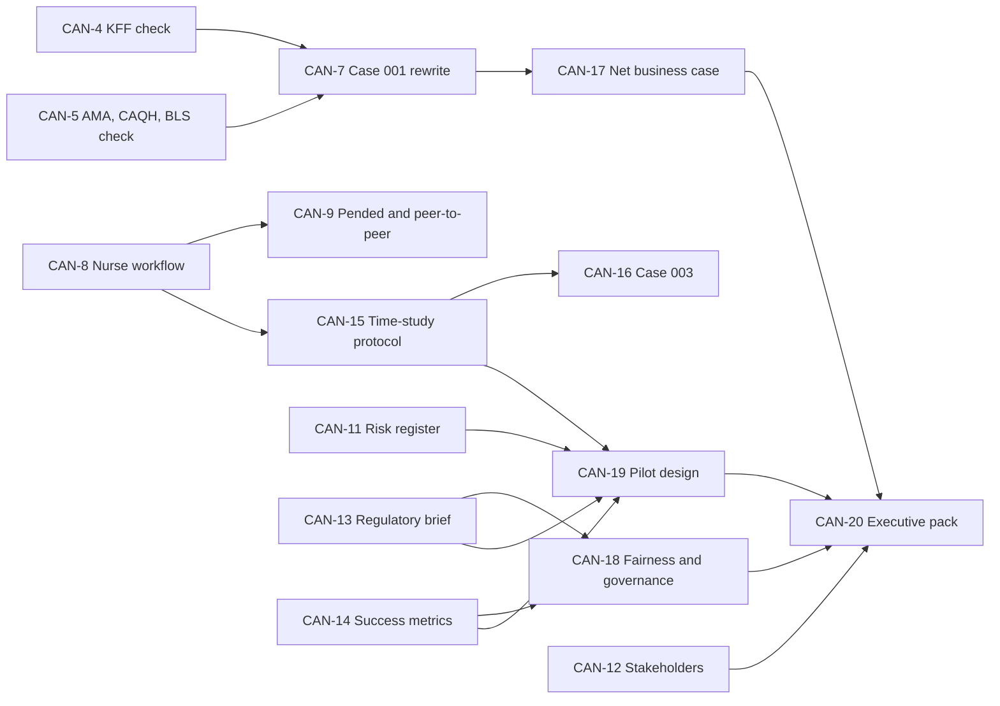

<!-- Review note: the project's ticket list, generated and ordered low to high complexity. Most important file in the repo. Edit only via roadmap-only commits on develop, then merge into open story branches. -->
# Project Canopy: Roadmap

Jira-style tickets to continue the business side of Project Canopy, ordered **low to high complexity**. Every ticket is one story, and every story gets its own branch.

[Overview](README.md) · [Cases](cases/README.md) · [Review summary](REVIEW_SUMMARY.md) · [Mental model](mental-model/README.md)

## 1. How we work

| Rule | Detail |
|---|---|
| Base branch | `develop`. Stories merge back into it when finished. |
| Story branch | One per ticket, named `story/CAN-<n>-<slug>`. **None are created yet.** We create them one at a time. |
| Dependencies | If a ticket depends on another, I flag it **before** its branch is created, and we decide together whether to wait or stack. |
| Complexity | XS 1 point, S 2, M 3, L 5, XL 8 to 13. Points reflect effort and uncertainty, not calendar time. |
| Evidence | Any number in a ticket's output goes in [`cases/registry.md`](cases/registry.md) first, with a grade. |

### Roadmap sync (this file is the same on every branch)

Git cannot share one file across branches on its own, so I keep it in step like this:

1. `ROADMAP.md` changes only in **roadmap-only commits on `develop`**. Story branches never edit it.
2. After each such commit, I merge `develop` into **every open story branch** so they all carry the same file.
3. If you ask for a roadmap change while a story branch is checked out, I switch to `develop`, commit there, merge it into the open branches, and switch back.
4. Marking a ticket done is also a roadmap-only commit on `develop`.

Because only `develop` edits it, the merges should never conflict. Each of my replies states the sync status.

## 2. Ladder (low to high complexity)

| Key | Ticket | Size | Pts | Depends on |
|---|---|---|---|---|
| CAN-1 | Remove the diff-check test line from the mental-model index | XS | 1 | none |
| CAN-2 | Fix the worked-example value (73.5 to 73.4375) in the README | XS | 1 | none |
| CAN-3 | Decide what to do with the two old remote branches | XS | 1 | your approval |
| CAN-4 | Verify the KFF figures against the primary report | S | 2 | network access |
| CAN-5 | Verify the AMA, CAQH and BLS figures | S | 2 | network access |
| CAN-6 | Write a plain-language glossary into the repo | S | 2 | none |
| CAN-7 | Rewrite Case 001 with case-type split, capacity conversion and error cost | M | 3 | CAN-4, CAN-5 |
| CAN-8 | Nurse workflow appendix: what the nurse sees, step by step | M | 3 | none |
| CAN-9 | Pended-case and peer-to-peer walkthroughs | M | 3 | CAN-8 |
| CAN-10 | Alternatives and competitor landscape | M | 3 | none |
| CAN-11 | Risk register with owners and triggers | M | 3 | none |
| CAN-12 | Stakeholder map and adoption plan | M | 3 | none |
| CAN-13 | Regulatory brief | L | 5 | network access |
| CAN-14 | Success metrics and measurement plan | L | 5 | none |
| CAN-15 | Reviewer time-study protocol | L | 5 | CAN-8 |
| CAN-16 | Case 003 with real plan-level data | L | 5 | CAN-15, data access |
| CAN-17 | Platform cost model and net business case v1 | L | 5 | CAN-7 |
| CAN-18 | Fairness and governance framework | XL | 8 | CAN-13, CAN-14 |
| CAN-19 | Shadow-mode pilot design | XL | 8 | CAN-11, CAN-13, CAN-14, CAN-15 |
| CAN-20 | Executive business case pack | XL | 13 | CAN-12, CAN-17, CAN-18, CAN-19 |

## 3. Dependency map

Tickets not in the diagram have no dependencies: CAN-1, 2, 3, 6 and 10. Tickets that start a chain (CAN-4, 5, 8, 11, 12, 13, 14) can also start any time. CAN-4, 5 and 13 need the research environment to reach external sites. CAN-16 also needs plan data from outside the repo.

## 4. Tickets

### Extra small (1 point)

**CAN-1 · Remove the diff-check test line from the mental-model index**
- Type: task. Practice story for the branch and merge workflow.
- Done when: `mental-model/README.md` no longer contains the "Test line" bullet, and the branch merges to `develop`.

**CAN-2 · Fix the worked-example value**
- Type: task. The README says S is about 73.5, exact arithmetic gives 73.4375.
- Done when: README line in section 9 matches `REVIEW_SUMMARY.md`, and the "known issue" note in the summary is removed or updated.

**CAN-3 · Decide what to do with the two old remote branches**
- Type: task. `claude/pensive-cannon-sunfb3` and `mental-model` are redundant after the merge to `develop`.
- Done when: you have chosen delete or keep, and the choice is carried out. Nothing is deleted without your approval.

### Small (2 points)

**CAN-4 · Verify the KFF figures**
- Type: spike. Read the primary KFF report and confirm S-01 to S-04 (determinations, denial, appeal and overturn rates).
- Done when: each row is upgraded from grade B to A, or corrected, in the registry, with the page cited.
- Needs: the research environment allowed to reach `www.kff.org`.

**CAN-5 · Verify the AMA, CAQH and BLS figures**
- Type: spike. Confirm S-05 (workload), S-06 (cost and minutes per request, latest CAQH edition) and S-07 (RN wage).
- Done when: each row is graded A or replaced, and the conflicting wage values are resolved.
- Needs: `www.ama-assn.org`, `www.caqh.org` and `www.bls.gov` reachable.

**CAN-6 · Write a plain-language glossary into the repo**
- Type: story. As a new reader, I want the key terms (prior authorization, tier, gate, shrinkage, and so on) defined once so I do not need the onboarding board.
- Done when: `docs/glossary.md` covers every term used in the README and cases, grouped by healthcare, model and business terms.

### Medium (3 points)

**CAN-7 · Rewrite Case 001**
- Type: story. Replace the single "minutes saved" with a split by case type (clean, pended, complex), add the capacity-to-dollars conversion, and add a cost-of-error term.
- Done when: arithmetic is shown for three scenarios, every input is in the registry, and the case says which results depend on a staffing decision.
- Depends on: CAN-4 and CAN-5, so the inputs are verified first.

**CAN-8 · Nurse workflow appendix**
- Type: story. Document what the nurse sees and decides at each of the five steps, including exits and where time goes.
- Done when: `cases/appendix-nurse-workflow.md` exists with a diagram, the decision points, and a clear note that it is illustrative until a time study replaces it.

**CAN-9 · Pended-case and peer-to-peer walkthroughs**
- Type: story. Same format as CAN-8 for the cases that cost the most: a document request loop and a physician peer-to-peer call.
- Done when: both flows are documented with minutes and cost per step, flagged as assumptions.
- Depends on: CAN-8 (shared format).

**CAN-10 · Alternatives and competitor landscape**
- Type: story. Compare do nothing, buy a vendor product, rules only, black-box AI, and our approach.
- Done when: each option has sourced facts, pros, cons and a stated reason we would or would not choose it.

**CAN-11 · Risk register**
- Type: story. Turn the risk table in the README into a register with owner, likelihood, impact, mitigation and an early-warning trigger.
- Done when: at least 12 risks are covered and each has an owner role, not a person.

**CAN-12 · Stakeholder map and adoption plan**
- Type: story. Nurses, medical directors, compliance, providers, patients, and IT and security. What each needs, fears and measures.
- Done when: each group has a one-line "what's in it for them", the likely objection, and our response.

### Large (5 points)

**CAN-13 · Regulatory brief**
- Type: story. Federal interoperability and prior-authorization timelines, state rules on AI in utilization review, and privacy obligations.
- Done when: every claim cites a primary source and the brief is marked "for legal review". It is not legal advice.
- Needs: web access to the primary sources.

**CAN-14 · Success metrics and measurement plan**
- Type: story. Define false-approval rate, reviewer agreement, minutes saved, SLA breaches and fairness measures, with formulas and how each is collected.
- Done when: every metric has a definition, a formula, a data source and an initial target marked as a placeholder.

**CAN-15 · Reviewer time-study protocol**
- Type: story. Design a study that replaces the invented step minutes with observed ones.
- Done when: the protocol covers sample size, case selection, an observation sheet, how to analyze it, and what result would change Case 001.
- Depends on: CAN-8 (the steps being timed).

**CAN-16 · Case 003 with real plan-level data**
- Type: story. Fill in the lumbar MRI case using one plan's actual volumes and rates.
- Done when: all inputs come from named data with grades, and the case shows results beside the safety metrics.
- Depends on: CAN-15, plus access to plan data (external).

**CAN-17 · Platform cost model and net business case v1**
- Type: story. Add build, hosting, model usage, oversight and maintenance cost, then net value and break-even by scenario.
- Done when: net value is shown for three scenarios, every cost line has an owner, and the break-even number is stated in requests per year.
- Depends on: CAN-7.

### Extra large (8 to 13 points)

**CAN-18 · Fairness and governance framework**
- Type: epic-sized story. How we audit outcomes by group, who approves changes to weights, how decisions are documented, and how issues are escalated.
- Done when: a roles-and-approvals diagram, an audit procedure, and a change-control process are written and reviewed.
- Depends on: CAN-13 and CAN-14.

**CAN-19 · Shadow-mode pilot design**
- Type: epic-sized story. Run alongside real reviewers with no effect on decisions. Scope, safeguards, staffing, timeline, go or no-go criteria.
- Done when: the design names one service line, the exact stop conditions, and who signs off at each gate.
- Depends on: CAN-11, CAN-13, CAN-14 and CAN-15.

**CAN-20 · Executive business case pack**
- Type: epic. One-page summary, narrative, verified evidence appendix, and answers to the likely objections.
- Done when: every figure traces to a graded registry row and a reviewer outside the project has read it.
- Depends on: CAN-12, CAN-17, CAN-18 and CAN-19.

## 5. Status

| Status | Tickets |
|---|---|
| To do | CAN-1 to CAN-20 |
| In progress | none |
| Done | none |
