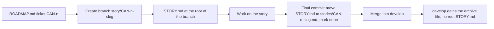
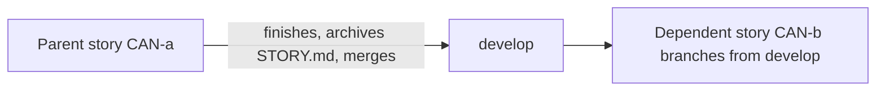

<!-- Review note: proposed rule for story branches and their root-level STORY.md. Draft, awaiting approval. Not yet reflected in ROADMAP.md. -->
# Story Branches and STORY.md

Proposed working rule. Every story gets its own branch, and each branch shows its own story overview at the root when checked out.

## 1. Lifecycle



## 2. What each branch looks like

```
story/CAN-1-remove-test-line  (open)        develop  (after the story merges)
├── STORY.md   <- unique to this branch     ├── stories/
├── README.md, ROADMAP.md, ...              │   └── CAN-1-remove-test-line.md
└── (same shared files as develop)          └── (no root STORY.md)
```

## 3. Rules

| Rule | Why |
|---|---|
| `STORY.md` exists only on its own story branch, at the root | Checking out a branch shows its story immediately |
| `develop` has no root `STORY.md` | Merges never collide, and syncing `develop` into a branch never touches the branch's story file |
| At the end of a story, the last commit moves `STORY.md` to `stories/CAN-<n>-<slug>.md` and marks it done | The story history builds up on `develop` without a root collision |
| `ROADMAP.md` stays the one list of tickets, the same on every branch | `STORY.md` is a briefing, not a second roadmap |
| The roadmap's status board is the source of truth for each ticket's status (Pending, In progress, Incomplete, Completed) | If a branch's `STORY.md` shows a different status, the board wins |
| I generate `STORY.md` when the branch is created and show it to you first | Nothing is pushed without your consent |

## 4. Dependent stories



A branch stacked on an unfinished parent would inherit the parent's `STORY.md` and clash with its own. So a dependent story starts only after its parent has archived its file and merged. If you want to stack anyway, I flag it before the branch is created and we decide together.

## 5. STORY.md template

```markdown
# CAN-<n>: <title>

Status: to do | in progress | done
Size and points: <size>, <points>
Branch: story/CAN-<n>-<slug>
Depends on: <tickets or none>

## Why this story exists
Business reason in plain language, two or three sentences.

## What this story covers
<diagram first>

### In scope
- ...

### Out of scope
- ...

## Inputs and outputs
| Reads | Creates or changes |
|---|---|
| ... | ... |

## Definition of done
- [ ] ...

## Open questions
- ...

## Links
Roadmap row, related cases, registry rows, mental-model files.
```

## 6. Decisions needed

- [ ] Is `STORY.md` at the root the right name?
- [ ] Is archiving to `stories/` at merge time acceptable?
- [ ] Should this rule be added to the "How we work" section of `ROADMAP.md`? That is a roadmap-only commit on `develop`.
