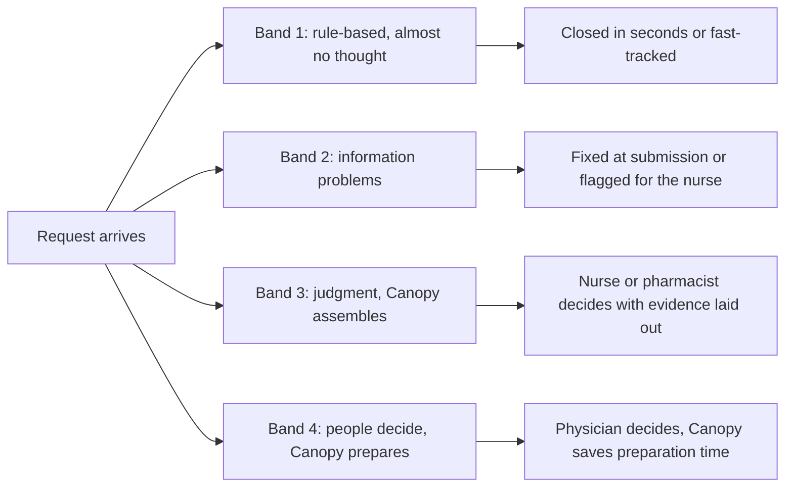

<!-- Review note: what Canopy would handle for the insurer, from very simple determinations to complex ones, with how each is done by hand today. Volume estimate uses registry rows S-01, S-08, S-09 and A-08. Patients, minutes and policies are invented for illustration (grade C). -->
# Manual Flow: Case Spectrum, Simple to Complex

## Contents

<!-- contents:start -->
- [0. Read this first](#0-read-this-first)
- [1. How many requests](#1-how-many-requests)
- [2. The four bands](#2-the-four-bands)
- [3. Band 1: very simple determinations](#3-band-1-very-simple-determinations)
  - [1a. No prior auth needed](#1a-no-prior-auth-needed)
  - [1b. Gold-carded provider](#1b-gold-carded-provider)
  - [1c. Clean approval](#1c-clean-approval)
- [4. Band 2: information problems](#4-band-2-information-problems)
  - [2a. Missing information](#2a-missing-information)
  - [2b. Conflicting records](#2b-conflicting-records)
  - [2c. Code doesn't match the notes](#2c-code-doesnt-match-the-notes)
  - [2d. Recent similar service](#2d-recent-similar-service)
- [5. Band 3: judgment, with Canopy assembling the evidence](#5-band-3-judgment-with-canopy-assembling-the-evidence)
  - [3a. A hidden emergency](#3a-a-hidden-emergency)
  - [3b. A borderline renewal](#3b-a-borderline-renewal)
  - [3c. Step-therapy exception](#3c-step-therapy-exception)
  - [3d. Partial approval](#3d-partial-approval)
  - [3e. Site of service](#3e-site-of-service)
- [6. Band 4: people decide, Canopy prepares](#6-band-4-people-decide-canopy-prepares)
  - [4a. Hospital stay extension](#4a-hospital-stay-extension)
  - [4b. Peer-to-peer and appeal](#4b-peer-to-peer-and-appeal)
  - [4c. No clear rule](#4c-no-clear-rule)
  - [4d. Another payer may be responsible](#4d-another-payer-may-be-responsible)
- [7. What the insurer gets beyond volume](#7-what-the-insurer-gets-beyond-volume)
- [8. What Canopy never does](#8-what-canopy-never-does)
<!-- contents:end -->

What Canopy would handle on the insurer's side, from requests that need almost no thought to ones that only people should decide, and how each is handled by hand today.

Related: [Lumbar MRI vs GLP-1 trace](lumbar-mri-vs-glp1-nurse-trace.md) · [How prior auth benefits the insurer](prior-auth-insurer-benefit-trace.md) · [Evidence registry](../cases/registry.md)

## 0. Read this first

- **Patients, minutes and policies are invented** to show the mechanics (grade C). Volume figures come from the [registry](../cases/registry.md).
- **Terminology.** "Adjudication" usually means processing a claim after care. For prior auth the decision is called a **determination**. This file uses determination.
- **Canopy's limits apply in every band.** It never denies. It approves on its own only where the insurer has written a rule that says so, such as "no prior auth required" or a gold-carded provider. Everything else ends with a person.

## 1. How many requests

There is **no published daily total** for UnitedHealthcare. This is an estimate:

| Input | Value | Source |
|---|---|---|
| All Medicare Advantage prior-auth determinations, 2024 | about 53.0 million | S-01, grade B |
| UnitedHealthcare's share | 25% to 33%, base 29% | A-08, grade C |
| UnitedHealthcare Medicare Advantage requests per year | 13.3 to 17.5 million, base 15.4 million | derived |

| Per day (Medicare Advantage only) | Low | Base | High |
|---|---|---|---|
| Per calendar day | about 36,300 | about 42,100 | about 47,900 |
| Per business day (250 a year) | about 53,000 | about 61,500 | about 70,000 |

- That's **tens of thousands a day, not thousands**, and it excludes commercial, Medicaid and pharmacy requests.
- State reports give a sense of the other lines. Illinois alone shows about 178,000 requests in 2024, roughly 490 a day, and Colorado about 77,000, roughly 210 a day (S-09). These probably cover only state-regulated plans.
- **The mix is changing.** UnitedHealthcare says it removed nearly 20% of its prior-auth volume in 2023, about 10% more in 2025, and plans to remove 30% of current volume in fall 2026 (S-08). If that last cut applied to the base estimate, Medicare Advantage would fall to about 29,500 a day.

The rules being removed are mostly the ones that are nearly always approved. So the remaining requests tilt toward bands 2 to 4 below, and that is where Canopy's value has to come from.

## 2. The four bands

| Band | What makes it hard | Canopy's role | Who decides |
|---|---|---|---|
| 1 | Nothing, it's a lookup or a clean match | Answers or fast-tracks | A rule, or a nurse in seconds |
| 2 | Evidence is missing, wrong or contradictory | Finds and flags it, often before the queue | Nurse |
| 3 | A real judgment against a rule | Builds the evidence and states the question | Nurse or pharmacist |
| 4 | High stakes or no clear rule | Prepares the file | Physician |

## 3. Band 1: very simple determinations

### 1a. No prior auth needed

**Case:** a lumbar X-ray (CPT 72100) submitted for prior auth out of habit. The plan doesn't require it.

| | Today | With Canopy |
|---|---|---|
| What happens | Intake opens the case, checks the plan's prior-auth list, closes it as "not required" and sends a notice | Checks the list at submission and tells the provider straight away. The request never enters the queue. |
| Staff time | about 4 minutes ($3.90) | none |
| Stays human | nothing | nothing |

### 1b. Gold-carded provider

**Case:** an orthopedist the plan has gold-carded for knee MRI requests a knee MRI (CPT 73721). The gold-card rule is the insurer's own policy, based on the provider's past approval rate.

| | Today | With Canopy |
|---|---|---|
| What happens | Staff confirm the provider's status and the service, then approve | Confirms both from the provider list and approves by the insurer's rule |
| Staff time | about 3 minutes | none, with a sampled audit later |
| Stays human | setting the gold-card rule | setting the rule and auditing samples |

### 1c. Clean approval

**Case:** the [lumbar MRI live case](lumbar-mri-vs-glp1-nurse-trace.md), with every criterion met and the evidence quoted.

| | Today | With Canopy |
|---|---|---|
| What happens | Nurse reads the packet, checks the criteria, writes the rationale | Tier A or B. Criteria pre-filled with quotes and a drafted rationale. The nurse confirms. |
| Staff time | 18 minutes ($17.55) | about 8 minutes ($7.80) |
| Stays human | the sign-off | the sign-off |

## 4. Band 2: information problems

### 2a. Missing information

**Case:** a knee MRI request says "failed PT" with no dates or visit count.

| | Today | With Canopy |
|---|---|---|
| What happens | The nurse finds the gap during review, days after submission. A pend letter goes out, and the clock waits. | At submission, the provider sees "C1 unclear: PT duration not documented. Attach PT notes with dates." Most gaps are fixed before the queue. |
| Stays human | the review once complete | the review once complete |

### 2b. Conflicting records

**Case:** the office note says 8 weeks of PT, and the PT summary is dated 3 weeks ago.

| | Today | With Canopy |
|---|---|---|
| What happens | Easy to miss, and if caught it's resolved by phone | The conflict is flagged with both quotes. Gate G5 caps the tier at C, so it can't be fast-tracked. |
| Stays human | which document to believe | which document to believe |

### 2c. Code doesn't match the notes

**Case:** the request is for an MRI with and without contrast (CPT 72158), but nothing in the notes supports contrast.

| | Today | With Canopy |
|---|---|---|
| What happens | Noticed if the nurse looks closely, then a call to the provider | The mismatch is flagged, along with the code the policy would support (72148) |
| Stays human | contacting the provider to amend the request | contacting the provider to amend the request |

### 2d. Recent similar service

**Case:** claims show a lumbar MRI five months ago, and the new request mentions new leg symptoms.

| | Today | With Canopy |
|---|---|---|
| What happens | Found only if the nurse searches claims | The earlier claim is shown with its date, alongside any quotes about new symptoms. Gate G1 sends it to a clinician. |
| Stays human | whether the new symptoms justify a repeat scan | whether the new symptoms justify a repeat scan |

## 5. Band 3: judgment, with Canopy assembling the evidence

### 3a. A hidden emergency

**Case:** back pain submitted as standard, but the note mentions urinary retention and saddle numbness.

| | Today | With Canopy |
|---|---|---|
| What happens | Waits in the standard queue until someone reads it | Red flags detected at intake. Moved to the expedited queue (72 hours) and flagged for immediate clinical outreach under the plan's procedures. |
| Stays human | the clinical response and the decision | the clinical response and the decision |

### 3b. A borderline renewal

**Case:** a GLP-1 renewal needs at least 5% weight loss. Baseline 192 lb, now 183.2 lb, a loss of **4.6%**. Pharmacy claims show six fills in six months.

| | Today | With Canopy |
|---|---|---|
| What happens | The weight history is rebuilt by hand from several notes | The weight trend and fill history are built automatically. Flagged "4.6% against a 5% threshold, adherence documented." |
| Stays human | whether 4.6% is close enough, decided by a physician | whether 4.6% is close enough, decided by a physician |

### 3c. Step-therapy exception

**Case:** rheumatoid arthritis. Adalimumab is requested. The policy requires 3 months of methotrexate first. Fill history shows 2 months, then it stopped. A note says it was stopped because liver tests rose.

| | Today | With Canopy |
|---|---|---|
| What happens | The pharmacist pieces together fills, labs and notes | Fill history, the lab result and the note quote are put side by side. Flagged "exception basis documented: stopped for a safety reason." |
| Stays human | granting the exception | granting the exception |

### 3d. Partial approval

**Case:** 24 physical therapy visits requested after surgery. The policy approves 12, then reassesses.

| | Today | With Canopy |
|---|---|---|
| What happens | The nurse checks the unit limits | The policy limit is shown. The nurse can approve 12 with a reassessment date. |
| Stays human | the other 12 visits. Turning them down is a partial denial, so it goes to a physician, or the provider withdraws them. | the same |

### 3e. Site of service

**Case:** an infusion requested at a hospital outpatient department. The policy prefers a home or infusion-center setting when clinically appropriate.

| | Today | With Canopy |
|---|---|---|
| What happens | Reviewer knowledge of the policy and the network | The site policy and in-network options are shown, with prices if available |
| Stays human | the clinical fit, agreed with the provider | the clinical fit, agreed with the provider |

## 6. Band 4: people decide, Canopy prepares

### 4a. Hospital stay extension

**Case:** day 3 after a hip replacement. The hospital asks for two more days because of post-surgery confusion.

| | Today | With Canopy |
|---|---|---|
| What happens | The nurse reads daily notes, vitals and therapy progress, then calls the hospital | Daily notes, vitals and therapy progress are assembled into a timeline against the criteria |
| Stays human | **the whole decision.** Automated decisions about hospital and post-acute stays have drawn legal and regulatory scrutiny, so Canopy only assembles. | the same |

### 4b. Peer-to-peer and appeal

**Case:** a denied MRI is appealed with a new exam showing weakness.

| | Today | With Canopy |
|---|---|---|
| What happens | The physician reviewer re-reads the whole file | One page: the original decision, what is new since (from the snapshot diff), and the appeal deadline |
| Stays human | the conversation and the appeal decision | the same |

### 4c. No clear rule

**Case:** an experimental treatment, or an out-of-network exception request.

| | Today | With Canopy |
|---|---|---|
| What happens | Medical director research | The relevant policy text and similar past decisions are pulled together |
| Stays human | everything | everything |

### 4d. Another payer may be responsible

**Case:** an injury marked as work-related.

| | Today | With Canopy |
|---|---|---|
| What happens | Caught at intake if the box is checked | Routed to coordination of benefits before any clinical review |
| Stays human | which payer is primary | which payer is primary |

## 7. What the insurer gets beyond volume

| Benefit | Why it matters |
|---|---|
| Nurse time moves to hard cases | Bands 1 and 2 shrink, so staff spend their time on bands 3 and 4 |
| Deadlines met | 72-hour and 7-day limits, and I believe new federal rules also require insurers to publish their prior-auth statistics |
| Fewer wrong denials | Missing information is caught early instead of becoming a denial that is later overturned (80.7% of appealed Medicare Advantage denials were overturned in 2024, S-04, grade B) |
| Defensible decisions | Every decision can be replayed for audits, appeals and lawsuits |
| Better provider relations | Clear reasons at submission instead of letters days later |
| Urgent cases found faster | Band 3a: emergencies move out of the standard queue |
| Smarter policy | Insights show which services are nearly always approved. That supports removing prior auth for them, which UnitedHealthcare already does (S-08). |

## 8. What Canopy never does

- Deny a request, or partly deny one.
- Decide on hospital or post-acute stays.
- Approve on its own outside a rule the insurer has written.
- Override a clinician's judgment on unclear or conflicting evidence.
- Recommend treatment to a provider or patient.
