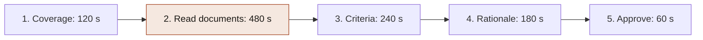
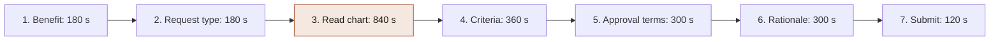

<!-- Review note: step-by-step trace of a nurse reviewer handling a lumbar MRI request and a GLP-1 request, with seconds per action. Case A now includes a live case (left erector spinae strain with new L5 radiculopathy) showing what the nurse double-checks and enters at each step. Portal names, patient data and timings are all invented for illustration (grade C). To be replaced by observed times from the time study (CAN-15). -->
# Manual Flow: Lumbar MRI vs GLP-1 (nurse reviewer)

## Contents

<!-- contents:start -->
- [0. Read this first](#0-read-this-first)
- [1. Overview in pictures](#1-overview-in-pictures)
- [2. Case A: Lumbar MRI (CPT 72148)](#2-case-a-lumbar-mri-cpt-72148)
  - [The live case at a glance](#the-live-case-at-a-glance)
  - [Step 1: Open case and confirm coverage (120 s)](#step-1-open-case-and-confirm-coverage-120-s)
  - [Step 2: Read the documents (480 s)](#step-2-read-the-documents-480-s)
  - [Step 3: Check the criteria (240 s)](#step-3-check-the-criteria-240-s)
  - [Step 4: Write the rationale (180 s)](#step-4-write-the-rationale-180-s)
  - [Step 5: Approve and send (60 s)](#step-5-approve-and-send-60-s)
  - [Case A totals: 1,080 s (18 min, $17.55 at $0.975 per minute)](#case-a-totals-1080-s-18-min-1755-at-0975-per-minute)
  - [What the muscle injury changes, and what-ifs](#what-the-muscle-injury-changes-and-what-ifs)
- [3. Case B: GLP-1 for weight management](#3-case-b-glp-1-for-weight-management)
  - [Step 1: Open case and identify the benefit (180 s)](#step-1-open-case-and-identify-the-benefit-180-s)
  - [Step 2: Classify the request and select criteria (180 s)](#step-2-classify-the-request-and-select-criteria-180-s)
  - [Step 3: Read the chart documents (840 s)](#step-3-read-the-chart-documents-840-s)
  - [Step 4: Check the criteria (360 s)](#step-4-check-the-criteria-360-s)
  - [Step 5: Set the approval terms (300 s)](#step-5-set-the-approval-terms-300-s)
  - [Step 6: Write the rationale (300 s)](#step-6-write-the-rationale-300-s)
  - [Step 7: Submit (120 s)](#step-7-submit-120-s)
  - [Case B totals: 2,280 s (38 min, $37.05 at $0.975 per minute)](#case-b-totals-2280-s-38-min-3705-at-0975-per-minute)
- [4. Side by side](#4-side-by-side)
- [5. What the time tells us](#5-what-the-time-tells-us)
- [6. Link to the business case](#6-link-to-the-business-case)
- [7. Caveats](#7-caveats)
<!-- contents:end -->

How a nurse handles two prior-authorization requests today, click by click, and why each step takes the time it does.

Related: [Case 001](../cases/001-medicare-advantage-reviewer-time.md) · [Evidence registry](../cases/registry.md) · [Roadmap](../ROADMAP.md) (CAN-8 nurse workflow, CAN-15 time study)

## 0. Read this first

- **Everything here is invented to show the mechanics.** The portal names, the patient data and the seconds are illustrative. Real organizations use their own systems or licensed criteria products such as MCG or InterQual.
- The nurse is already logged into her main work tool. Opening a second system sometimes means a single sign-on prompt, which is included in the times.
- A time study (CAN-15) would replace the seconds with observed values.
- Case A follows one live case, a weightlifter with a low-back muscle strain and new nerve symptoms. Its panels show what the nurse double-checks and enters. The patient, dates, codes and system entries are invented. The codes follow standard coding (CPT 72148, 72100, 97110, 97140; ICD-10 S39.012D, M54.16), but a coder should confirm them before any real use.

**Row types**

| Type | Meaning |
|---|---|
| Check | Verify a labelled field or tick a box |
| Read | Pull facts out of unstructured pages |
| Judge | Decide what the facts mean against a rule |
| Write | Type or retype |
| Wait | The system is loading |

**Invented portals**

| Side | Portals |
|---|---|
| Medical (MRI) | UM Workbench, Eligibility Lookup, Criteria Library, Document Imaging Viewer, Claims Viewer |
| Pharmacy (GLP-1) | Rx PA Queue, Rx Eligibility and Benefits, Plan Design Lookup, Formulary Lookup, Rx Claims Console (plus Criteria Library and Document Imaging Viewer) |

## 1. Overview in pictures

Shaded step = the heaviest step in each case.

## 2. Case A: Lumbar MRI (CPT 72148)

**Live case (invented):** member M-48213, 41, male, a recreational weightlifter. On 2026-08-22 he strained the muscles of the left low back (the erector spinae at L4-L5) on a heavy deadlift and felt a pop. After 10 weeks of conservative care, new left leg numbness and mild big-toe weakness appeared. His orthopedist (sports medicine) requests a lumbar MRI. Standard urgency, received 2026-11-05, due 2026-11-12. The packet is 6 pages: a referral form, a 3-page typed office note from 2026-11-04, and a 2-page faxed physical therapy summary with a handwritten discharge note.

Each step below keeps the generic seconds table, then adds a **Live case** panel: what this patient's paperwork contains, what the nurse double-checks, and what she enters. The seconds do not change.

### The live case at a glance

| Date | Event |
|---|---|
| 2026-08-22 | Deadlift injury. Sharp pain in the left low back and a pop. |
| 2026-08-29 | Naproxen 500 mg twice daily prescribed for 3 weeks, then as needed. |
| 2026-09-02 | Urgent care lumbar X-ray (CPT 72100). Normal. |
| 2026-09-08 | Physical therapy starts. |
| 2026-10-14 | New numbness down the left outer calf to the top of the foot. |
| 2026-11-03 | PT discharge after 14 visits. Symptoms persist. |
| 2026-11-04 | Orthopedic visit. Neuro findings documented, MRI ordered. |
| 2026-11-05 | Request received. |
| 2026-11-06 | Nurse review and decision (6 days before the deadline). |
| 2026-11-12 | Decision deadline for a standard request. |

### Step 1: Open case and confirm coverage (120 s)

| # | Portal | What she does and sees | Sec | Type |
|---|---|---|---|---|
| 1.1 | UM Workbench | Opens the top case in her queue. Reads the header: member, requester, code, diagnosis, deadline clock. | 10 | Check |
| 1.2 | Eligibility Lookup | Pastes the member ID. Confirms active on the service date, plan type, provider in network. | 35 | Check |
| 1.3 | UM Workbench (benefits panel) | Confirms advanced imaging needs prior auth on this plan. | 20 | Check |
| 1.4 | UM Workbench | Searches for an earlier or duplicate request for this member and code. | 25 | Check |
| 1.5 | Criteria Library | Picks the lumbar MRI policy by code. Confirms the version in effect. | 30 | Check |

**Why this long:** every row is a labelled field with a yes or no. Time goes to switching windows and signing in, not thinking. It is a checkbox step.

**Live case, step 1: coverage**

| Where | What she sees | What she double-checks |
|---|---|---|
| UM Workbench, header | Case UM-2026-1105-0418. Member M-48213, 41, male. CPT 72148. Diagnoses S39.012D (strain of lower-back muscle, subsequent encounter) and M54.16 (lumbar radiculopathy). Ordering provider Dr. A. Patel, orthopedic sports medicine. Facility Riverbend Imaging, outpatient. Received 2026-11-05, standard, due 2026-11-12. | Today is 2026-11-06, so 6 days remain. The request is not marked expedited. |
| Eligibility Lookup | Active 2026-01-01 to 2026-12-31, commercial PPO, no other coverage on file. | Provider and facility are both in network, and coverage covers the planned service window. |
| UM Workbench, benefits panel | Advanced imaging needs prior authorization. | 72148 is on this plan's prior-auth list. |
| Request form, accident boxes | Employment: no. Auto accident: no. Other accident: no. | Because this is an injury, she makes sure no other payer is primary (workers' comp, auto coverage, a liable third party). A gym lift with no one else involved means none. If any box were yes, she would stop and route to coordination of benefits. |
| Request form, diagnosis codes | S39.012D and M54.16. | M54.16 is on the policy's covered diagnosis list. S39.012D alone would not be, because a muscle strain is not by itself an MRI indication. |
| UM Workbench, duplicate search | No earlier 72148 request or approval for this member. | The search covers the same code and any other lumbar MRI code. |
| Criteria Library | RAD-MRI-LSPINE v2026.1, effective 2026-01-01. | The version is in effect on the received date. |

**She enters**

| Field | Value |
|---|---|
| Coverage verified | Yes, 2026-11-06 |
| Other payer or liability | None |
| Policy applied | RAD-MRI-LSPINE v2026.1 |
| Review path | Nurse level, standard |

### Step 2: Read the documents (480 s)

| # | Portal | What she does and sees | Sec | Type |
|---|---|---|---|---|
| 2.1 | Document Imaging Viewer | Opens the packet and counts pages: referral, office note, PT fax. | 15 | Check |
| 2.2 | Document Imaging Viewer | Referral form: confirms diagnosis and ordering provider match the case. | 30 | Check |
| 2.3 | Document Imaging Viewer | Office note, history section: pain duration, leg radiation, and where it says what treatment was tried. | 150 | Read |
| 2.4 | Document Imaging Viewer | Office note, exam and review of systems: straight-leg raise, strength, sensation, red-flag questions. | 120 | Read |
| 2.5 | Document Imaging Viewer | Faxed PT summary: skewed scan. Finds start and end dates and visit count, and reads a handwritten discharge note. | 130 | Read |
| 2.6 | Document Imaging Viewer | Compares the note and PT dates. Do they agree? | 20 | Judge |
| 2.7 | Document Imaging Viewer | Scans for mentions of earlier imaging. | 15 | Read |

**Why this long:** this is the heavy step. The facts she needs are scattered across three documents in three formats. Nothing is structured, and the fax is the slowest to read. 150 + 120 + 130 seconds is mostly finding a few facts in dense text.

**Live case, step 2: what she pulls out of the packet**

| Fact | Where she finds it | Value |
|---|---|---|
| Injury and mechanism | Office note, page 1, history | Deadlift on 2026-08-22, felt a pop in the left low back. Clinically a strain of the left L4-L5 paraspinal muscles, partial tear suspected. |
| Medication | Office note, page 1 | Naproxen 500 mg twice daily from 2026-08-29 for 3 weeks, then as needed. |
| Therapy | Office note page 1, PT summary pages 1 and 2 | PT from 2026-09-08 to 2026-11-03, 14 visits, discharged with persistent symptoms. Home exercise program. |
| New symptoms | Office note, page 1 | Since about 2026-10-14, numbness down the left outer calf to the top of the foot. |
| Exam | Office note, page 2 | Left straight-leg raise positive at 40 degrees. Reduced light touch over the left L5 area. Left big-toe extension 4/5. Reflexes 2+ and symmetric. Normal gait. Spasm and tenderness over the left L4-L5 paraspinals. |
| Red-flag questions | Office note, page 2 | Denies bowel or bladder change, saddle numbness, fever and weight loss. No cancer history. |
| Prior imaging | Office note, page 1 | Lumbar X-ray on 2026-09-02, normal. |

**What she double-checks**
- **Negations.** "Denies saddle numbness" means the red flag is absent, not present.
- **Dates agree.** The note says 8 weeks of PT, and the PT summary dates (09-08 to 11-03) give exactly 8 weeks.
- **Exam against review of systems.** The review of systems says "denies leg weakness", but the exam finds mild big-toe weakness. She treats the dated exam as the stronger evidence and records both.
- **Copied text.** The exam has specific values (40 degrees, 4/5), not template wording such as "neuro intact", so it reflects this visit.
- **The stated reason for the scan.** The order says "evaluate for nerve root compression and exclude high-grade muscle tear." She notes that the second reason is not a policy criterion.

**She enters.** Nothing final yet. She types short evidence notes in the case note field, each with a page reference, for use in steps 3 and 4.

### Step 3: Check the criteria (240 s)

| # | Portal | What she does and sees | Sec | Type |
|---|---|---|---|---|
| 3.1 | Criteria Library | Opens the checklist next to the documents. | 10 | Check |
| 3.2 | Criteria Library | Criterion 1: 6+ weeks conservative care or a red flag. She records 8 weeks of PT plus NSAIDs with the page reference. | 40 | Judge |
| 3.3 | Criteria Library | Criterion 2: radiculopathy or neuro deficit. Leg pain with numbness, positive straight-leg raise. Met. | 45 | Judge |
| 3.4 | Claims Viewer | Re-authenticates, enters the member ID, sets 12 months and the lumbar MRI code family, waits for results. | 90 | Check |
| 3.5 | Criteria Library | Criterion 3: no lumbar MRI in 12 months. Claims show none. Met. | 15 | Check |
| 3.6 | Criteria Library | All three met. Confirms no exclusion flag is raised. Decides she can approve at her level. | 40 | Judge |

**Why this long:** the judgment rows are short because the documents were clear. The claims search is long only because of sign-in and loading. A messier note would stretch 3.2 and 3.3.

**Live case, step 3: criteria and claims**

| Criterion | She enters | Evidence cited | Result |
|---|---|---|---|
| C1: 6+ weeks of conservative care, or a red flag | 10.6 weeks of conservative care, 2026-08-22 to 2026-11-04. Naproxen from 08-29. PT 14 visits, 09-08 to 11-03. Activity modification. | Office note page 1, PT summary pages 1 and 2, claims | Met |
| C2: radiculopathy or neurologic deficit | Left L5 radiculopathy. Straight-leg raise positive at 40 degrees, reduced sensation over the L5 area, big-toe extension 4/5. | Office note page 2, exam of 2026-11-04 | Met |
| C3 exclusion: lumbar MRI in the last 12 months | No lumbar MRI (72148, 72149 or 72158) between 2025-11-06 and 2026-11-06. | Claims Viewer | Not triggered |
| Red flag | None documented, so C1 is met through duration, not a red flag. | Office note page 2 | None |

**In the Claims Viewer**
- She enters member M-48213, 2025-11-06 to 2026-11-06, and uses the all-outpatient-services view, not only an MRI code filter.
- She sees one **plain-film X-ray (CPT 72100)** on 2026-09-02 at an urgent care. She double-checks it is radiography, not an MRI, so it does not trigger the exclusion.
- She sees **14 physical therapy claims** (CPT 97110 and 97140) from 2026-09-08 to 2026-11-03. That corroborates the PT dates in the fax, which counts for more than a note alone.
- She sees no 72148, 72149 or 72158.

**The injury-specific judgment.** She does not count the muscle strain as meeting C2. The strain explains how the problem began. C2 rests on the nerve findings in the exam. If the note had documented only the strain, C2 would be unmet.

### Step 4: Write the rationale (180 s)

| # | Portal | What she does and sees | Sec | Type |
|---|---|---|---|---|
| 4.1 | UM Workbench | Selects "Approve, criteria met." | 15 | Check |
| 4.2 | UM Workbench | Types the rationale, about 90 words: each criterion, evidence, page references. | 140 | Write |
| 4.3 | UM Workbench | Attaches the criteria checklist. | 25 | Check |

**Why this long:** typing is nearly all of it, and it repeats facts she just read in step 2.

**Live case, step 4: what she enters**

| Field | Value |
|---|---|
| Decision | Approve |
| Basis | Criteria met |
| Policy | RAD-MRI-LSPINE v2026.1 |
| Criteria results | C1 Met. C2 Met. C3 exclusion not triggered. |
| Attachment | Criteria checklist (PDF) |

**Rationale she types** (about 85 words):

> Approve CPT 72148 per RAD-MRI-LSPINE v2026.1. 41M with left L4-L5 paraspinal strain (deadlift, 08/22/2026) and new left L5 radiculopathy. C1 met: 10.6 weeks of conservative care (naproxen from 08/29; PT 09/08 to 11/03, 14 visits, corroborated by claims 97110 and 97140; activity modification). C2 met: ortho note 11/04 documents left SLR positive at 40 degrees, reduced L5 sensation, EHL 4/5. C3 met: no lumbar MRI in 12 months; 09/02/2026 plain films only (72100). No red flags documented. Not work- or accident-related.

**What she double-checks before saving.** Every date and number in the rationale matches the notes she cites. The word "approve" matches the decision field. She does not write a medical opinion on the injury, only what the criteria and documents show.

### Step 5: Approve and send (60 s)

| # | Portal | What she does and sees | Sec | Type |
|---|---|---|---|---|
| 5.1 | UM Workbench | Confirms code, 1 unit and validity dates (90 days). | 25 | Check |
| 5.2 | UM Workbench | Submits. | 20 | Check |
| 5.3 | UM Workbench | Waits while letters generate and the clock closes. | 15 | Wait |

**Why this long:** pure confirmation. Wrong dates cause claim problems later, so she looks twice.

**Live case, step 5: what she enters and confirms**

| Field | Value | What she double-checks |
|---|---|---|
| Authorized service | CPT 72148, 1 unit | Matches the request exactly. A different code or unit count would be rejected at billing. |
| Facility | Riverbend Imaging, outpatient, in network | Same facility as the request. |
| Valid dates | 2026-11-06 through 2027-02-03 (90 days) | The window starts today and the count is right. |
| Authorization number | Assigned by the system (for example PA-2611-0418) | She copies it into her case note. |
| Notifications | Provider (fax or portal) and member (mail or app) | Both are ticked. The member letter says approval is not a guarantee of payment. |
| Deadline clock | Closed on 2026-11-06, 6 days before 2026-11-12 | The case shows as completed on time. |

### Case A totals: 1,080 s (18 min, $17.55 at $0.975 per minute)

| Type | Seconds | Share |
|---|---|---|
| Check | 365 | 33.8% |
| Read | 415 | 38.4% |
| Judge | 145 | 13.4% |
| Write | 140 | 13.0% |
| Wait | 15 | 1.4% |

### What the muscle injury changes, and what-ifs

**Checks an injury adds, compared with ordinary back pain**

| Check | Why it matters for an injury |
|---|---|
| Accident and liability boxes | Another payer may be primary, such as workers' comp, auto coverage or a liable third party. |
| Subsequent-encounter diagnosis code | Shows ongoing care for an earlier injury. A strain code alone does not meet the MRI criteria. |
| Strain versus nerve findings | The strain is the cause. The criterion rests on radiculopathy or a deficit, and the nurse must not let one stand in for the other. |
| Plain-film X-ray in claims | Not an exclusion. Only an earlier MRI is. |
| Where the clock starts | Conservative care counts from the injury, not from the first PT visit. Claims for PT corroborate the dates. |

**Variations on the same patient** (typical handling, which varies by plan)

| Variation | What changes | Likely outcome |
|---|---|---|
| Same strain, 3 weeks old, no leg symptoms | C1 unmet (3 weeks, no red flag) and C2 unmet. | The nurse cannot approve. She refers it to a physician reviewer, who decides. Denials are made only by a physician. |
| Strain plus saddle numbness and urinary retention | A red flag is present, so C1 is met without waiting 6 weeks. Neuro findings meet C2. | Fast approval, with expedited handling for a possible emergency. |
| Strain, a lumbar MRI 5 months ago, and new leg symptoms | The exclusion applies unless new symptoms are documented. | She refers it so a reviewer can decide whether the new symptoms justify a repeat scan. |

## 3. Case B: GLP-1 for weight management

**Invented case:** member M-77120, 46, female. New start of a weekly injectable GLP-1, standard urgency, pharmacy benefit. The fax packet is 11 pages: three office notes (about 8, 3 and 1 months before), a one-page lifestyle program letter, a one-page lab report, and a referral. Current height 5'6", weight 192 lb, BMI 31.0 (the note says 31.0 and the arithmetic checks). Earlier weights 200 lb and 196 lb. Hypertension and high cholesterol. The program letter shows 7 months enrolled and 12 of 28 sessions attended.

### Step 1: Open case and identify the benefit (180 s)

| # | Portal | What she does and sees | Sec | Type |
|---|---|---|---|---|
| 1.1 | Rx PA Queue | Opens the case. Reads drug, dose, quantity, diagnosis, prescriber. | 15 | Check |
| 1.2 | Rx Eligibility and Benefits | Confirms active, pharmacy benefit, plan group. | 35 | Check |
| 1.3 | Plan Design Lookup | Opens the plan's rider document and searches for the weight-loss drug provision. Reads whether this plan covers it and under what conditions. | 50 | Read |
| 1.4 | Rx PA Queue | Searches for open or duplicate requests for the member. | 35 | Check |
| 1.5 | Formulary Lookup | Confirms the drug is on formulary, its tier, whether PA is required, and the quantity limit. | 45 | Check |

**Why this long:** mostly checkable fields, but 1.3 is the first unstructured reading, because plan riders are documents, not fields. This step decides whether the case is even eligible, which the MRI never needs to ask.

### Step 2: Classify the request and select criteria (180 s)

| # | Portal | What she does and sees | Sec | Type |
|---|---|---|---|---|
| 2.1 | Rx PA Queue | Decides whether this is a new start, renewal, switch or dose change, from the form and the member's PA history. | 40 | Check |
| 2.2 | Rx Claims Console | Signs in, enters member ID, sets a 12-month fill history, waits. | 75 | Check |
| 2.3 | Rx Claims Console | Scans the fills. Sees blood pressure and cholesterol medication, no GLP-1 or other weight-loss drug. | 45 | Read |
| 2.4 | Criteria Library | Opens the anti-obesity drug policy. Confirms the version, selects new-start criteria. | 20 | Check |

**Why this long:** pharmacy fill history is evidence in itself. It confirms comorbidities and rules out a duplicate drug. Pulling it is a retrieval chore, and reading it is brief.

### Step 3: Read the chart documents (840 s)

| # | Portal | What she does and sees | Sec | Type |
|---|---|---|---|---|
| 3.1 | Document Imaging Viewer | Opens the 11-page packet and sorts it into notes, letter, labs, referral. | 30 | Check |
| 3.2 | Document Imaging Viewer | Latest note: height, weight, BMI. Re-computes BMI from weight and height as a check. | 150 | Read |
| 3.3 | Document Imaging Viewer | Latest note, assessment and plan: indication wording, comorbidities, contraception or pregnancy status, thyroid history. | 150 | Read |
| 3.4 | Document Imaging Viewer | Two earlier notes: pulls handwritten weights (200, then 196 lb) to see the trend. | 150 | Read |
| 3.5 | Document Imaging Viewer | Lifestyle program letter: enrollment dates (7 months) and attendance (12 of 28). Scanned stamp. | 100 | Read |
| 3.6 | Document Imaging Viewer | Lab page: A1c, lipids, thyroid function, used to support the comorbidity and thyroid questions. | 70 | Read |
| 3.7 | Document Imaging Viewer | Scans past medical and family history for thyroid cancer, MEN2, pancreatitis, and other safety exclusions. | 90 | Read |
| 3.8 | Document Imaging Viewer | Compares weights: 200 to 192 lb is a loss of 8 lb, 4.0%. What does that say about the program? | 40 | Judge |
| 3.9 | Document Imaging Viewer | Rotates and zooms skewed fax pages to read handwritten values. | 60 | Read |

**Why this long:** this is the heavy step, and it is heavier than the MRI's reading step for a clear reason. The MRI needs a handful of facts from three documents. This case needs a dozen facts from five kinds of document, and several are time series (three weights over time) that must be assembled by hand. Each fact is small, but there are many, and some are handwritten.

### Step 4: Check the criteria (360 s)

| # | Portal | What she does and sees | Sec | Type |
|---|---|---|---|---|
| 4.1 | Criteria Library | C1: BMI 30 or more, or 27 with a comorbidity. BMI 31.0 documented and checked. Met. | 40 | Check |
| 4.2 | Criteria Library | C2: structured lifestyle program, 6 months or more. 7 months enrolled. Attendance is only 12 of 28. Is that adequate? She decides it meets the policy wording and notes the attendance. | 90 | Judge |
| 4.3 | Criteria Library | C3: no personal or family history of thyroid cancer or MEN2. Documented none known. | 40 | Judge |
| 4.4 | Criteria Library | C4: not pregnant or planning pregnancy. Note says IUD in place. | 35 | Judge |
| 4.5 | Criteria Library | C5: no other GLP-1 active. Claims showed none. | 20 | Check |
| 4.6 | Formulary Lookup | Confirms the starting dose and 4 pens per 28 days fit the titration schedule and quantity limit. | 60 | Check |
| 4.7 | Criteria Library | Overall: everything met with one caveat. Approve with conditions, or refer? She approves with a renewal note. | 75 | Judge |

**Why this long:** four of the seven rows are judgment. The program row 4.2 is the longest because the policy asks for participation and the evidence shows weak attendance, so she has to decide what counts. The MRI had no such case.

### Step 5: Set the approval terms (300 s)

| # | Portal | What she does and sees | Sec | Type |
|---|---|---|---|---|
| 5.1 | Rx PA Queue | Selects "Approve, new start" and a 6-month duration. | 30 | Check |
| 5.2 | Rx PA Queue | Sets the quantity and the titration schedule. | 70 | Check |
| 5.3 | Rx PA Queue | Sets the renewal condition: weight loss of at least 5% from baseline, plus the documents needed, and a reminder at month 5. | 90 | Check |
| 5.4 | Rx PA Queue | Re-reads the formulary notes for any preferred-brand or plan-specific condition. | 40 | Check |
| 5.5 | Rx PA Queue | Types a flag for the renewal reviewer about the low program attendance. | 70 | Write |

**Why this long:** an MRI approval is one date range. A drug approval is a set of terms that create a future task. Every field is a checkbox, but there are many of them, and a wrong one creates a coverage gap or a pharmacy rejection.

### Step 6: Write the rationale (300 s)

| # | Portal | What she does and sees | Sec | Type |
|---|---|---|---|---|
| 6.1 | Rx PA Queue | Writes about 150 words: each criterion, BMI math, program dates and attendance, exclusion screen, claims check, why approved with a caveat. | 240 | Write |
| 6.2 | Rx PA Queue | Attaches the checklist and the claims screenshot. | 60 | Check |

**Why this long:** more criteria, more evidence to cite, and a caveat to explain. It is the same retyping as the MRI, only longer.

### Step 7: Submit (120 s)

| # | Portal | What she does and sees | Sec | Type |
|---|---|---|---|---|
| 7.1 | Rx PA Queue | Summary screen: drug, strength, quantity, duration, member and prescriber. | 45 | Check |
| 7.2 | Rx PA Queue | Submits. The determination goes to the prescriber and the member, and the pharmacy system is updated so the pharmacy can fill. | 30 | Check |
| 7.3 | Rx PA Queue | Waits for confirmation that the pharmacy system picked up the approval. | 45 | Wait |

**Why this long:** the wait matters. If the pharmacy system does not sync, the patient is turned away at the counter even though the approval exists.

### Case B totals: 2,280 s (38 min, $37.05 at $0.975 per minute)

| Type | Seconds | Share |
|---|---|---|
| Check | 780 | 34.2% |
| Read | 865 | 37.9% |
| Judge | 280 | 12.3% |
| Write | 310 | 13.6% |
| Wait | 45 | 2.0% |

## 4. Side by side

| | Lumbar MRI | GLP-1 |
|---|---|---|
| Steps | 5 | 7 |
| Total time | 18 min | 38 min |
| Cost at $0.975 per minute | $17.55 | $37.05 |
| Heaviest step | Step 2, reading: 480 s (44% of the case) | Step 3, reading: 840 s (37% of the case) |
| Judgment time | 145 s | 280 s |
| Reading plus writing | 555 s (51%) | 1,175 s (52%) |
| Checkbox steps | 1 and 5 | 1, 5 and 7 |

## 5. What the time tells us

1. **Checkbox steps are justified by caution, not effort.** Eligibility, submit and confirmation take the same time whatever the case looks like, because errors there are costly. They are short and can't be shrunk much.
2. **Reading is the biggest block in both, because the evidence is unstructured.** It is slow because facts are scattered, scanned or handwritten, not because the facts are hard to understand.
3. **Judgment is the smallest block in both, but it is the part that carries risk.** In the GLP-1 case it is also where the nurse leaves the happy path, for example deciding whether attendance counts as participation.
4. **Writing is mostly retyping.** Both cases repeat the facts she just read.
5. **The GLP-1 case is about twice as long (2.1 times) for three reasons:** more facts per case, evidence that has to be assembled over time, and approval terms that create a future task.

## 6. Link to the business case

Case 001's base assumption is that a fast lane saves 10 of the MRI's 18 minutes. In this trace, the reading and writing rows add up to 555 seconds, about 9 minutes, so the assumption is plausible but not proven. For the GLP-1, the same logic gives up to about 19.6 minutes of reading and writing, with the checks and judgment still needing a nurse.

## 7. Caveats

- Every portal name, number and timing is an invented placeholder (grade C).
- The shares are similar across the two cases partly because both were built from the same assumptions. Observed data may differ.
- Real workflows differ by plan and by system. Some plans auto-approve at step 1 for trusted providers, and many drug requests are reviewed by pharmacists, not nurses.
