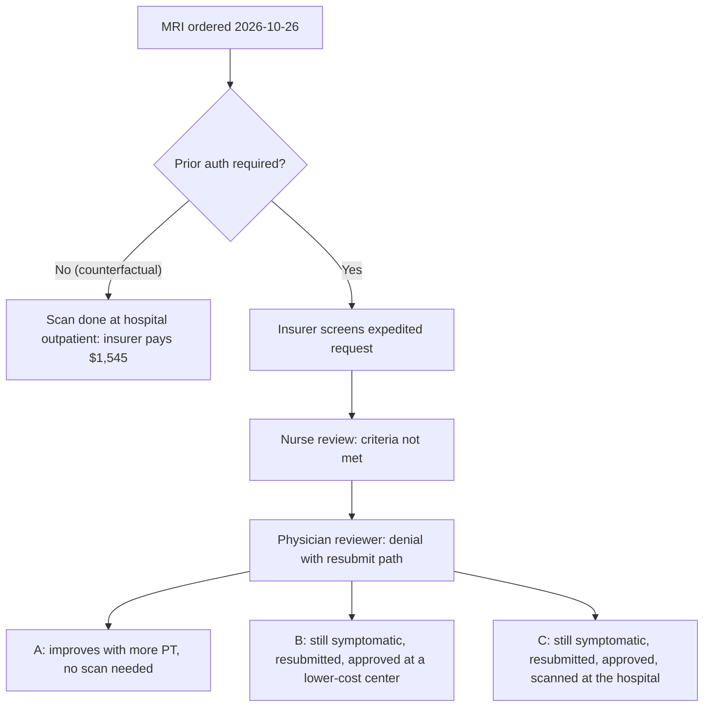

<!-- Review note: live case showing, step by step, how prior authorization benefits the insurer, with an invented cost ledger and the counterfactual without prior auth. All patients, prices, minutes and probabilities are invented for illustration (grade C). -->
# Manual Flow: How Prior Auth Benefits the Insurer

## Contents

<!-- contents:start -->
- [0. Read this first](#0-read-this-first)
- [1. The live case](#1-the-live-case)
- [2. Two paths in one picture](#2-two-paths-in-one-picture)
- [3. Step by step at the insurer](#3-step-by-step-at-the-insurer)
  - [Step 1: The request arrives (2026-10-27)](#step-1-the-request-arrives-2026-10-27)
  - [Step 2: Expedited screen by a nurse (6 min, $5.85)](#step-2-expedited-screen-by-a-nurse-6-min-585)
  - [Step 3: Clinical review by a nurse (18 min, $17.55)](#step-3-clinical-review-by-a-nurse-18-min-1755)
  - [Step 4: Physician reviewer decision (15 min, $37.50)](#step-4-physician-reviewer-decision-15-min-3750)
  - [Step 5: Six weeks later, three branches](#step-5-six-weeks-later-three-branches)
- [4. Why this adds up for the insurer](#4-why-this-adds-up-for-the-insurer)
- [5. Who pays for that benefit](#5-who-pays-for-that-benefit)
- [6. Where Canopy changes this case](#6-where-canopy-changes-this-case)
<!-- contents:end -->

One live case, followed from the moment the request arrives at the insurer to what happens six weeks later, with what the insurer pays at each point and what it would have paid without prior authorization.

Related: [Lumbar MRI vs GLP-1 trace](lumbar-mri-vs-glp1-nurse-trace.md) · [Case 001](../cases/001-medicare-advantage-reviewer-time.md) · [Evidence registry](../cases/registry.md)

## 0. Read this first

- **Everything here is invented to show the mechanics.** The patient, the prices, the minutes and the probabilities are illustrative (grade C). Real prices vary widely by plan, region and facility.
- Staff cost uses the same rates as the other trace: a nurse at $0.975 per minute, and a physician reviewer at an assumed $2.50 per minute.
- Prices are **allowed amounts**: the total the insurer and patient pay together. The patient's share (deductible or coinsurance) is left out to keep the arithmetic simple.
- The example policy is the same one as the lumbar trace: at least 6 weeks of conservative care or a red flag, plus nerve findings, and no lumbar MRI in the last 12 months.

## 1. The live case

**Member M-51907, 38, male, office worker (invented).** On 2026-10-03 he moved furniture and developed a painful low-back muscle spasm. His primary care physician examined him and found no nerve problems, ran routine bloodwork, and referred him to physical therapy in the same hospital. After about two weeks of therapy he is still in a lot of pain, and the physician orders a lumbar MRI. The hospital's prior-auth team submits it marked **expedited** because of the pain, and attaches the PCP notes and the PT notes.

| Date | Event |
|---|---|
| 2026-10-03 | Spasm starts after lifting furniture. |
| 2026-10-05 | PCP visit. Normal nerve exam, no red flags, bloodwork, PT referral. |
| 2026-10-12 to 2026-10-23 | Physical therapy, 6 visits. |
| 2026-10-26 | PCP follow-up. Pain persists, nerve exam still normal. MRI ordered. |
| 2026-10-27 | Hospital submits the request, marked expedited. |
| 2026-11-03 | Standard-review deadline (7 days after receipt). |
| 2026-11-14 | Six weeks since the spasm began. |

## 2. Two paths in one picture



## 3. Step by step at the insurer

### Step 1: The request arrives (2026-10-27)

| What arrives | Detail |
|---|---|
| Request | CPT 72148, lumbar MRI without contrast. Marked expedited. Reason given: "severe pain." |
| Diagnoses | M62.830 (muscle spasm of back), M54.50 (low back pain, unspecified) |
| Facility | The hospital's outpatient imaging department |
| Attachments | 4 pages: PCP notes from 10-05 and 10-26, PT notes from 10-12 to 10-23 |

**Insurer benefit at this step:** the request exists before any money is spent. Nothing has been paid, and the insurer gets to look first.

### Step 2: Expedited screen by a nurse (6 min, $5.85)

| What she checks | What she finds | What she enters |
|---|---|---|
| Does waiting up to 7 days risk serious harm to health or recovery? | Severe pain, but no red flags: no weakness, no bladder or bowel change, no saddle numbness, no fever. | "Expedited criteria not met. Processed as standard. Due 2026-11-03." |
| Notices | The provider and member must be told it was moved to standard. | Notice sent to both. |

**Insurer benefit at this step:** the urgent queue stays reserved for real emergencies. If every painful case were expedited, true emergencies would wait behind them.

### Step 3: Clinical review by a nurse (18 min, $17.55)

Same five steps as the [lumbar trace](lumbar-mri-vs-glp1-nurse-trace.md). The results differ:

| Criterion | Evidence | Result |
|---|---|---|
| C1: 6+ weeks of conservative care, or a red flag | 3.3 weeks since onset (10-03 to 10-26), 2 weeks of PT, no red flag | **Not met** |
| C2: radiculopathy or nerve deficit | Normal nerve exam on 10-05 and 10-26 | **Not met** |
| C3: no lumbar MRI in 12 months | Claims show none | Met |

She cannot approve, and a nurse cannot deny. She enters "Criteria not met: C1, C2. Referred to physician reviewer."

**Insurer benefit at this step:** the policy is applied the same way to every member. Without it, each scan would depend only on how hard each doctor or patient pushed.

### Step 4: Physician reviewer decision (15 min, $37.50)

| What happens | Detail |
|---|---|
| Review | The medical director reads the nurse summary and the notes. |
| Peer-to-peer | Offered to the ordering physician. Not requested in this case. |
| Decision | Denial (adverse determination). Reason: fewer than 6 weeks of conservative care and no nerve findings or red flags. |
| Path forward | Letter explains how to appeal, and says a new request may be submitted after 2026-11-14 or sooner if new symptoms appear. |
| Notices and system | Letters to provider and member ($3.00). |

**Admin cost so far: $63.90** ($5.85 + $17.55 + $37.50 + $3.00).

**Insurer benefit at this step:** the $1,545 scan is not paid now. If the hospital scanned anyway without approval, the later claim would be denied for "no authorization on file."

### Step 5: Six weeks later, three branches

| Branch | What happens | Insurer pays for the scan | Admin cost | Saving vs no prior auth |
|---|---|---|---|---|
| **A** | Pain eases with more PT. No scan needed. | $0 | $63.90 | **$1,481.10** |
| **B** | Still symptomatic. Resubmitted 2026-11-17 with 6+ weeks of care. Approved by a nurse ($17.55). The approval lists a lower-cost in-network imaging center ($480 facility + $95 radiologist), and the patient chooses it. | $575 | $81.45 | **$888.55** |
| **C** | Same as B, but scanned at the hospital outpatient department. | $1,545 | $81.45 | **-$81.45** |

Without prior auth, the scan would have happened on 2026-10-28 at the hospital outpatient department: $1,450 facility + $95 radiologist = **$1,545**.

## 4. Why this adds up for the insurer

**One request, weighted by invented odds** (A 60%, B 25%, C 15%):

```
0.60 x  1,481.10 =   888.66
0.25 x    888.55 =   222.14
0.15 x  (-81.45) =   -12.22
expected saving per request      = 1,098.58
across 1,000 similar requests    = about $1.10 million
```

The odds drive the answer. Most acute low-back pain improves within weeks, which is why branch A is the largest, but the exact share is a guess until real data replaces it.

**Where the insurer's benefit comes from**

| Lever | In this case |
|---|---|
| Avoiding a scan that doesn't meet the policy | Branch A: $1,545 never spent |
| Steering to a lower-cost site | Branch B: $970 less for the same scan |
| Protecting the urgent queue | Step 2: an expedited slot kept free |
| Consistency | Step 3: the same rule for every member |
| No later claim fight | Step 4: an unapproved scan is simply not payable |

## 5. Who pays for that benefit

| Party | What it costs them in this case |
|---|---|
| Insurer | $63.90 to $81.45 of staff time per request, plus the cost of any appeal |
| Hospital | Prior-auth staff time to submit and follow up, and a scan it cannot schedule yet |
| Patient | More weeks in pain before a scan (branch B and C), and stress |

**Where the benefit turns into harm.** Branch A is a legitimate saving only if he truly got better. If he still needed the scan but gave up, the "saving" is unmet care. Appeals show the same risk: in Medicare Advantage, most denials that are appealed are overturned (80.7% in 2024, registry S-04, grade B), which means some denials were wrong.

## 6. Where Canopy changes this case

If the hospital had seen at submission that C1 was 3.3 of 6 weeks and C2 was unmet, it likely would not have sent an expedited request that was going to fail. The insurer saves the 39 minutes of review in steps 2 to 4. The hospital saves its follow-up. The patient gets a clear message straight away: resubmit after 2026-11-14, or sooner if new symptoms appear.
