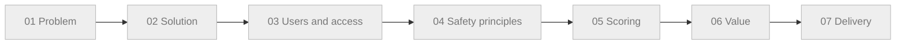

<!-- Review note: navigation index for the mental model. Holds no content claims; topics are added only after they are confirmed as understood. -->
# Mental Model: Prior Authorization Copilot (business side)

Navigation index. Each topic folder holds short files with one diagram each. A point appears here only after it has been confirmed as understood.

## How to read this

- Start at the map, open a topic folder, follow the breadcrumbs at the top of each file.
- Grey in the map means not covered yet.
- Test line, added only to check the diff view. Safe to delete.

## Map

## Coverage

| Topic | Status |
|---|---|
| 01 Problem | not started |
| 02 Solution | not started |
| 03 Users and access | not started |
| 04 Safety principles | not started |
| 05 Scoring | not started |
| 06 Value | not started |
| 07 Delivery | not started |
